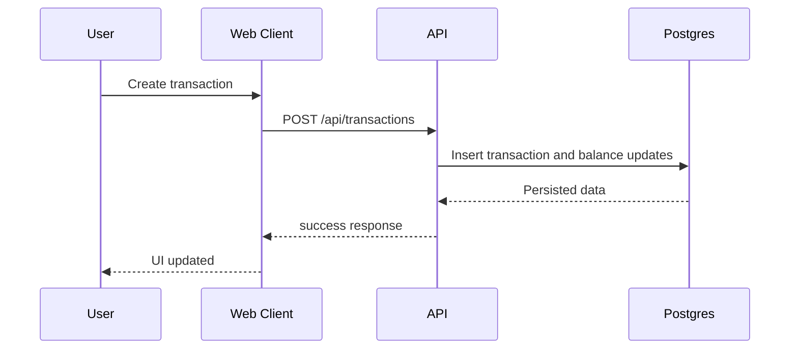
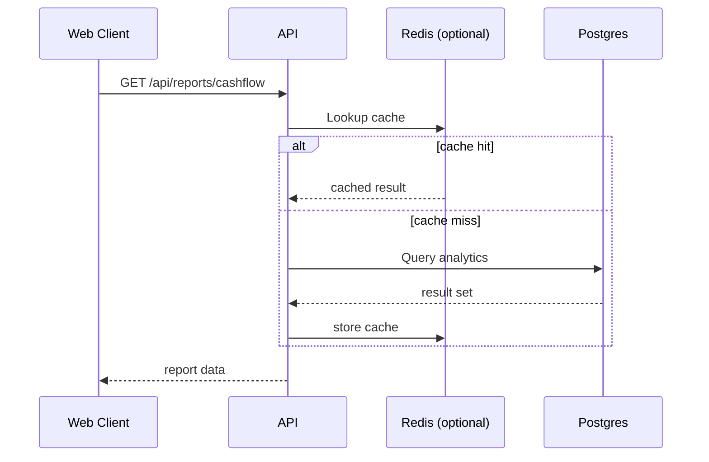

# Architecture Diagrams

## System Context
```mermaid
flowchart LR
  User[User] -->|Browser| WebClient[React Web Client]
  WebClient -->|HTTP/JSON| Api[Express API]
  Api -->|SQL| Db[(PostgreSQL)]
  Api -->|Cache (optional)| Redis[(Redis)]
  Api -->|Files| Uploads[(Uploads Folder)]
  Cron[External Cron] -->|X-Cron-Secret| Api
```

## Transaction Flow


## Analytics Report Flow


## Notes
- Redis cache is optional and enabled via `REDIS_URL`.
- Uploads are served from the local `uploads/` directory.
