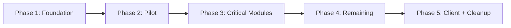

# Personal Finance App - Complete Refactoring Specification

> **Date:** 2026-01-09
> **Scope:** Server architecture, client UI, shared libraries, fintech correctness, security and compliance
> **Audience:** Engineering, QA, Product, Compliance
> **Status:** Consolidated Specification

---

## Related Documents

| Document | Purpose |
| -------- | ------- |
| [Security Fixes Guide](../reviews/phase-0-security-fixes.md) | Security fixes implementation (Phase 0) |
| [Security Audit Report](../reviews/security-audit-report-2026-01-13-v3.md) | Full vulnerability assessment |
| [Calculation Engine Report](calculation-engine-completion-report.md) | Completed calculation engine refactor |

> [!IMPORTANT]
> **Security-First Refactoring**: Critical security issues identified in the Security Audit Report must be resolved in **Phase 0** before proceeding with architecture changes. See the [Security Fixes Guide](../reviews/phase-0-security-fixes.md) for implementation details.

---

## Executive Summary

This specification provides a **comprehensive refactoring plan** for the Personal Finance App, modernizing the codebase with clear domain boundaries, deterministic money handling, and fintech-grade security controls.

### What's Already Excellent

| Component | Status |
| --------- | ------ |
| **Authentication** | Session-based with HTTP-only cookies, bcrypt (12 rounds) |
| **Authorization** | Household-based roles (owner > admin > member > view_only) |
| **Validation** | Zod schemas throughout, entity validation middleware |
| **Logging** | Structured logger with PII redaction at `server/utils/logger.ts` |
| **Rate Limiting** | General, auth, and analytics limiters configured |
| **Data Access** | Clean Drizzle ORM layer in `server/storage.ts` |
| **Testing** | Vitest + React Testing Library + property-based tests |
| **Calculation Engine** | Already refactored in `server/core/` |

### Key Outcomes

| Outcome | Target |
| ------- | ------ |
| Largest server file | < 500 LOC |
| Largest client file | < 300 LOC |
| Core test coverage | > 80% |
| Report response time | < 150 ms |
| Cache hit rate | > 70% |

### Priority Matrix

| Area | Priority | Impact | Effort | Notes |
| ---- | -------- | ------ | ------ | ----- |
| Security remediation (Phase 0) | 🔴 Critical | High | Low | See Security Fixes Guide |
| ReportRepository split | 🔴 High | High | Medium | Reduce God object (2975 LOC → 6 files) |
| Route handler extraction | 🔴 High | High | Medium | Clear domain boundaries |
| Transaction domain service | 🔴 High | High | Medium | Fintech correctness, idempotency |
| Modular monolith structure | 🔴 High | High | High | Industry-standard architecture |
| Centralized validation | 🟡 Medium | Medium | Low | Consistent API contracts |
| Event-driven + outbox | 🟡 Medium | High | High | Decouple workflows |
| Caching layer | 🟡 Medium | High | Medium | Performance |
| Client decomposition | 🔴 High | High | Medium | Maintainable UI |
| Shared money utilities | 🔴 High | High | Low | Deterministic calculations |

---

## Scope and Goals

**In Scope:**
- Improve maintainability and testability across server and client
- Reduce coupling between business workflows
- Establish security, audit, and compliance baselines
- Create clear delivery phases with measurable outcomes

**Out of Scope (this phase):**
- Major product feature changes unrelated to refactoring
- Large UI redesigns not required by refactor

**Non-Goals:**
- No immediate compliance certification (PCI DSS, SOC 2, ISO 27001)
- No new external integrations unless required by refactor

---

## Current State Analysis

### Server Structure Issues

```text
server/
├── routes/        ← 30 files (some 40-57KB) 🔴 Business logic mixed in
├── services/      ← 35 files (some 20-35KB) 🟡 Good layer, but bloated
├── repositories/  ← 10 files (one 90KB!) 🔴 God Object anti-pattern
├── middleware/    ← 6 files ✅ Good separation
├── validation/    ← 7 files ✅ Good practice
├── utils/         ← 5 files ✅ Utility functions
├── core/          ← 56 files ✅ Calculation Engine (well done!)
├── jobs/          ← 4 files ✅ Background jobs
└── types/         ← 1 file ✅ Shared types
```

### Key Problem Files

| File | Size | Issue |
| ---- | ---- | ----- |
| `ReportRepository.ts` | 2,975 LOC / 90KB | God Object - 28 methods |
| `investments.ts` (route) | 57KB | Trading + holdings + analytics mixed |
| `settings.ts` (route) | 40KB | User + household + preferences mixed |
| `GoalService.ts` | 35KB | Too many responsibilities |
| `RecurringService.ts` | 30KB | Complex workflows |

### Client Issues

- Transactions page is a monolith (~1.5k LOC) mixing data, UI, and modal logic
- Recurring and Investments pages are large and mix view + data logic
- Some UI paths mutate cached data or use uncontrolled inputs

### Shared Issues

- No single source of truth for money, date, error, and ID utilities

---

## Design Principles

1. **Domain boundaries first** - Organize around business domains (transactions, reports, investments, settings)
2. **Thin controllers** - Routes only orchestrate, no business rules
3. **Service layer owns invariants** - Single source of truth for business rules
4. **Repository layer is query-only** - Reusable data access
5. **Explicit contracts** - All inputs validated and typed
6. **Deterministic money** - Decimal math, explicit currency, stable rounding
7. **Auditability** - Record who changed what and why
8. **Observable by default** - Structured logs, metrics, trace IDs

---

## Target Architecture: Modular Monolith

Based on app size (35+ services) and industry best practices, **Modular Monolith with Feature-Based Structure** is recommended.

### Why Modular Monolith?

| Benefit | Description |
| ------- | ----------- |
| Feature isolation | Each domain is self-contained |
| Parallel development | Teams work on different modules |
| Easy navigation | All related code in one place |
| Microservices ready | Easy to extract later |
| Single deployment | Simple ops |

### Target Flow

```text
Request -> Controller -> Service -> Repository
                      -> Domain Events -> Outbox -> Jobs

Client UI -> Feature Modules -> Query Hooks -> API Contracts
```

### Proposed Structure

```text
server/
├── app.ts                          # Express app setup
├── index.ts                        # Entry point
├── config/                         # Environment config
│
├── core/                           # Shared infrastructure
│   ├── calculations/               # ← Already done! ✅
│   ├── database/                   # DB connection, migrations
│   ├── errors/                     # AppError, NotFoundError, etc.
│   ├── events/                     # Event emitter, handlers
│   ├── cache/                      # Caching abstraction
│   ├── http/                       # Request/response helpers
│   ├── money/                      # Money, FX, rounding utilities
│   └── validation/                 # Shared validation schemas
│
├── modules/                        # Feature modules
│   ├── auth/
│   │   ├── auth.controller.ts      # Route handlers
│   │   ├── auth.service.ts         # Business logic
│   │   ├── auth.repository.ts      # Data access
│   │   ├── auth.validation.ts      # Zod schemas
│   │   ├── auth.types.ts           # Module-specific types
│   │   ├── auth.routes.ts          # Express routes
│   │   └── __tests__/              # Module tests
│   │
│   ├── transactions/
│   │   ├── transactions.controller.ts
│   │   ├── transactions.service.ts
│   │   ├── transactions.repository.ts
│   │   ├── transactions.validation.ts
│   │   ├── transactions.events.ts  # Domain events
│   │   ├── transactions.routes.ts
│   │   └── __tests__/
│   │
│   ├── accounts/
│   │   └── ... (same pattern)
│   │
│   ├── goals/
│   │   ├── goals.controller.ts
│   │   ├── goals.service.ts        # Uses core/calculations/goals
│   │   ├── goal-assignments.service.ts
│   │   ├── goal-activity.service.ts
│   │   ├── goals.repository.ts
│   │   ├── goals.routes.ts
│   │   └── __tests__/
│   │
│   ├── budgets/
│   │   └── ...
│   │
│   ├── investments/
│   │   ├── holdings/               # Sub-module
│   │   │   ├── holdings.controller.ts
│   │   │   ├── holdings.service.ts
│   │   │   └── holdings.routes.ts
│   │   ├── portfolio/              # Sub-module
│   │   ├── analytics/              # Sub-module
│   │   └── index.ts                # Re-exports all routes
│   │
│   ├── reports/
│   │   ├── spending/               # Split the God Object!
│   │   │   ├── spending.service.ts
│   │   │   └── spending.controller.ts
│   │   ├── cashflow/
│   │   ├── networth/
│   │   ├── annual/
│   │   └── index.ts
│   │
│   ├── recurring/
│   ├── notifications/
│   ├── merchants/
│   └── settings/
│       ├── user-settings/          # Sub-module
│       ├── household-settings/     # Sub-module
│       └── ...
│
├── shared/                         # Cross-cutting concerns
│   ├── middleware/                 # Express middleware
│   ├── decorators/                 # Custom decorators
│   └── guards/                     # Auth guards
│
└── jobs/                           # Background jobs
    ├── price-update.job.ts
    ├── recurring-sync.job.ts
    └── ...
```

---

## Workstreams Overview

| # | Workstream | Priority | Description |
| - | ---------- | -------- | ----------- |
| 0 | **Security Remediation** | 🔴 CRITICAL | Fix authorization gaps, remove debug logging |
| 1 | Server domain decomposition | 🟡 HIGH | Split God objects, extract modules |
| 2 | Shared libraries and utilities | 🟡 HIGH | Money, validation, error handling |
| 3 | Eventing, caching, and background jobs | 🟡 MEDIUM | Decouple workflows |
| 4 | Client feature modularization | 🟡 MEDIUM | Split large pages |
| 5 | Security hardening & observability | 🟢 ONGOING | Audit logging, structured logs |

---

## Phase 0: Security Remediation (1-2 days)

> **See: [Security Fixes Guide](../reviews/phase-0-security-fixes.md)** for complete implementation details.

This phase addresses all findings from the Security Audit Report:

| Priority | Findings | Effort |
| -------- | -------- | ------ |
| **P0 - Immediate** | Admin auth, PII logging, file-based logging | 2 hours |
| **P1 - This Week** | CORS, import auth, dev token exposure | 3 hours |
| **P2 - This Sprint** | Account lockout, audit logging, security headers | 8 hours |

**Definition of Done for Phase 0:**
- [ ] All admin routes protected with `requireAuth` + admin role
- [ ] No `console.log` statements with user IDs or PII
- [ ] No file-based error logging
- [ ] CORS requires explicit origin in production
- [ ] All file upload endpoints require authentication

---

## Phase 1: Foundation (Week 1-2)

```text
[ ] Create core/errors with AppError, NotFoundError, ValidationError
[ ] Create core/events with EventEmitter pattern
[ ] Create core/http with standardized responses
[ ] Create core/money with Money utilities (extend from calculations)
[ ] Split ReportRepository into domain-specific repositories
[ ] Create modules/ directory structure
```

---

## Phase 2: Pilot Modules (Week 3-4)

```text
[ ] Migrate auth module as pilot
    - auth.controller.ts (from routes/auth.ts handlers)
    - auth.service.ts (from services/SessionService.ts)
    - auth.routes.ts (just route definitions)
[ ] Add TransactionService with invariants
[ ] Implement centralized validation registry
[ ] Verify patterns work well
```

---

## Phase 3: Critical Modules (Week 5-8)

```text
[ ] Migrate transactions module
[ ] Migrate accounts module
[ ] Migrate goals module (consolidate 4 services)
[ ] Event-driven + outbox pattern
[ ] Caching layer abstraction
[ ] Background jobs refactor
```

---

## Phase 4: Remaining Modules (Week 9-12)

```text
[ ] Migrate reports (split into spending, cashflow, networth, annual)
[ ] Migrate investments (split into holdings, portfolio, analytics)
[ ] Migrate settings (split into user, household, preferences)
[ ] Migrate remaining modules
```

---

## Phase 5: Client & Cleanup (Week 13-16)

```text
[ ] Client refactor: Transactions, Recurring, Investments pages
[ ] Chart config extraction
[ ] UI component tests
[ ] Remove old routes/, services/, repositories/
[ ] Update all imports
[ ] Final documentation
```

---

## Global Requirements

### Architecture Requirements

- No business logic inside route handlers
- Every domain has controllers, services, repositories, and validation schemas
- Cross-domain workflows must be event-driven or background jobs
- Shared utilities live in `shared/` or `server/core`

### Code Quality Requirements

- Max file sizes:
  - Server route files < 500 LOC
  - Client page files < 300 LOC
  - React components < 200 LOC (unless purely presentational)
- Avoid `any` in new code; use types or guards
- Prefer pure functions for transforms; no in-place mutation
- No direct DOM manipulation in React

### Fintech Correctness Requirements

- Monetary values use decimal-safe types with explicit currency
- FX conversions are deterministic and reference rate source + timestamp
- Idempotency for retryable write endpoints
- Audit trail for critical operations (create/update/delete transactions, imports)

### Operational Requirements

- Structured logging with correlation IDs
- Error responses are consistent and machine-readable
- Background jobs are retryable and observable
- Backups and data retention policies are documented

---

# Technical Specifications

---

## API Versioning Strategy

### Versioning Approach

Use **URL path versioning** for major API changes:

```text
/api/v1/transactions  # Current stable
/api/v2/transactions  # During refactor (if breaking changes needed)
```

### Backward Compatibility Rules

| Change Type | Compatibility | Action |
| ----------- | ------------- | ------ |
| Add new field to response | ✅ Compatible | No version bump |
| Add optional query param | ✅ Compatible | No version bump |
| Add required field to request | ❌ Breaking | Version bump or default |
| Remove/rename field | ❌ Breaking | Version bump |
| Change field type | ❌ Breaking | Version bump |

### Deprecation Policy

```typescript
// Add deprecation headers to old endpoints
res.setHeader("Deprecation", "true");
res.setHeader("Sunset", "Sat, 01 Apr 2026 00:00:00 GMT");
res.setHeader("Link", '</api/v2/transactions>; rel="successor-version"');
```

**Timeline:**
- Announce deprecation: 3 months before removal
- Sunset period: 3 months with both versions active
- Removal: After sunset period with monitoring

### Documentation

- All API changes documented in docs\operations\changelog.md
- OpenAPI spec updated for each version
- Migration guide for breaking changes

---

## Database Migration Safety

### Zero-Downtime Migration Patterns

**Expand-Contract Pattern:**

```text
Phase 1: Expand
- Add new columns/tables (nullable or with defaults)
- Deploy code that writes to both old and new
- Code still reads from old

Phase 2: Migrate
- Backfill data to new structure
- Validate data consistency

Phase 3: Contract
- Switch reads to new structure
- Remove writes to old
- Drop old columns (separate migration)
```

### Migration Commands

```bash
# Generate migration
npm run db:migrate:create split_report_repository

# Apply migration (staging first)
npm run db:migrate:up

# Rollback if needed
npm run db:migrate:down

# Validate migration
npm run db:migrate:validate
```

### Data Backfill Strategy

```typescript
// Backfill script template
async function backfillNewColumn() {
  const BATCH_SIZE = 1000;
  let processed = 0;

  while (true) {
    const batch = await db
      .select()
      .from(transactions)
      .where(isNull(transactions.newColumn))
      .limit(BATCH_SIZE);

    if (batch.length === 0) break;

    for (const row of batch) {
      await db
        .update(transactions)
        .set({ newColumn: computeValue(row) })
        .where(eq(transactions.id, row.id));
    }

    processed += batch.length;
    console.log(`Backfilled ${processed} rows`);

    // Throttle to avoid DB pressure
    await sleep(100);
  }
}
```

### Rollback Procedures

| Scenario | Rollback Action |
| -------- | --------------- |
| Migration fails mid-way | Transaction rollback (if supported) |
| Data corruption detected | Restore from backup + replay WAL |
| Performance degradation | Revert code, keep new schema |
| Logic error in new code | Feature flag off, old code path |

---

## Feature Flags Framework

### Flag Naming Convention

```text
refactor.<domain>.<feature>

Examples:
- refactor.reports.splitRepository
- refactor.transactions.newService
- refactor.client.transactionsList
```

### Flag Storage

```typescript
// server/config/featureFlags.ts
export interface FeatureFlags {
  "refactor.reports.splitRepository": boolean;
  "refactor.transactions.newService": boolean;
  "refactor.client.transactionsList": boolean;
  "refactor.events.outbox": boolean;
}

// Load from environment or config service
export function getFlag(name: keyof FeatureFlags): boolean {
  return process.env[`FF_${name.toUpperCase().replace(/\./g, "_")}`] === "true";
}
```

### Usage Pattern

```typescript
// Server-side
if (getFlag("refactor.transactions.newService")) {
  return newTransactionService.create(input, ctx);
} else {
  return legacyTransactionService.create(input);
}

// Client-side
const useNewTransactionsList = useFeatureFlag(
  "refactor.client.transactionsList"
);
```

### Gradual Rollout

```typescript
// Percentage-based rollout
function isEnabledForUser(flag: string, userId: string): boolean {
  const rolloutPercentage = getRolloutPercentage(flag);
  const hash = hashUserId(userId); // Deterministic 0-100
  return hash < rolloutPercentage;
}
```

### Emergency Kill Switch

```bash
# Immediate disable via environment
export FF_REFACTOR_TRANSACTIONS_NEWSERVICE=false

# Or via config endpoint (if implemented)
curl -X POST /api/admin/feature-flags \
  -d '{"flag": "refactor.transactions.newService", "enabled": false}'
```

---

## Dependency Injection

### Approach

Use **manual constructor injection** for simplicity. Consider `tsyringe` for larger scale.

```typescript
// Manual DI (current approach)
class TransactionService {
  constructor(
    private readonly repository: TransactionRepository,
    private readonly eventBus: EventBus,
    private readonly auditLog: AuditLogger
  ) {}
}

// Composition root
const transactionRepository = new TransactionRepository(db);
const eventBus = new EventBus();
const auditLog = new AuditLogger(db);
const transactionService = new TransactionService(
  transactionRepository,
  eventBus,
  auditLog
);
```

### Testing with Mocks

```typescript
// Unit test with mocks
describe("TransactionService", () => {
  it("creates transaction and emits event", async () => {
    const mockRepo = { create: vi.fn().mockResolvedValue(mockTx) };
    const mockEventBus = { emit: vi.fn() };
    const mockAudit = { log: vi.fn() };

    const service = new TransactionService(mockRepo, mockEventBus, mockAudit);
    await service.create(input, ctx);

    expect(mockEventBus.emit).toHaveBeenCalledWith(
      "transaction.created",
      expect.any(Object)
    );
  });
});
```

---

## Configuration Management

### Configuration Structure

```typescript
// server/config/index.ts
export interface AppConfig {
  env: "development" | "staging" | "production";
  database: DatabaseConfig;
  cache: CacheConfig;
  auth: AuthConfig;
  features: FeatureFlags;
  limits: RateLimitConfig;
}

// Load and validate at startup
export const config = loadConfig();
validateConfig(config); // Throws if invalid
```

### Environment-Specific Configs

```text
.env.development
.env.staging
.env.production
.env.test
```

### Config Validation

```typescript
import { z } from "zod";

const configSchema = z.object({
  DATABASE_URL: z.string().url(),
  REDIS_URL: z.string().url().optional(),
  SESSION_SECRET: z.string().min(32),
  NODE_ENV: z.enum(["development", "staging", "production", "test"]),
});

export function validateConfig(env: NodeJS.ProcessEnv): void {
  const result = configSchema.safeParse(env);
  if (!result.success) {
    console.error("Invalid configuration:", result.error.flatten());
    process.exit(1);
  }
}
```

---

## Rate Limiting

### Rate Limit Tiers

| Tier | Scope | Read Limit | Write Limit | Window |
| ---- | ----- | ---------- | ----------- | ------ |
| Standard | Per user | 100 req | 20 req | 1 min |
| Household | Per household | 500 req | 100 req | 1 min |
| Import | Per user | 5 req | 5 req | 1 hour |
| Export | Per user | 10 req | - | 1 hour |
| Admin | Per user | 50 req | 20 req | 1 min |

### Response Headers

```text
X-RateLimit-Limit: 100
X-RateLimit-Remaining: 45
X-RateLimit-Reset: 1704789600
Retry-After: 60  # Only on 429 response
```

### Implementation

```typescript
// middleware/rateLimit.ts
import rateLimit from "express-rate-limit";
import RedisStore from "rate-limit-redis";

export const apiLimiter = rateLimit({
  store: new RedisStore({ client: redisClient }),
  windowMs: 60 * 1000, // 1 minute
  max: (req) => (req.user?.isAdmin ? 50 : 100),
  keyGenerator: (req) => req.user?.id || req.ip,
  standardHeaders: true,
  legacyHeaders: false,
});

export const importLimiter = rateLimit({
  windowMs: 60 * 60 * 1000, // 1 hour
  max: 5,
  message: {
    success: false,
    error: { code: "RATE_LIMITED", message: "Import limit exceeded" },
  },
});
```

---

## Health Checks

### Endpoints

| Endpoint | Purpose | Checks |
| -------- | ------- | ------ |
| `GET /health/live` | Is process running? | Always returns 200 |
| `GET /health/ready` | Can accept traffic? | DB, cache, dependencies |
| `GET /health/startup` | Has initialized? | Migrations, warmup |

### Response Format

```typescript
// Healthy
{
  "status": "healthy",
  "checks": {
    "database": { "status": "healthy", "latency": 5 },
    "cache": { "status": "healthy", "latency": 2 },
    "external_api": { "status": "healthy", "latency": 50 }
  },
  "version": "1.2.3",
  "uptime": 86400
}

// Unhealthy
{
  "status": "unhealthy",
  "checks": {
    "database": { "status": "unhealthy", "error": "Connection refused" },
    "cache": { "status": "healthy", "latency": 2 }
  }
}
```

### Graceful Shutdown

```typescript
process.on("SIGTERM", async () => {
  console.log("Received SIGTERM, starting graceful shutdown");

  // Stop accepting new requests
  server.close();

  // Wait for in-flight requests (max 30s)
  await waitForConnections(30000);

  // Close database connections
  await db.end();

  // Close Redis
  await redis.quit();

  console.log("Graceful shutdown complete");
  process.exit(0);
});
```

---

## Performance Budgets

### API Latency Targets

| Endpoint Type | P50 | P95 | P99 | Timeout |
| ------------- | --- | --- | --- | ------- |
| List queries (paginated) | 50ms | 100ms | 200ms | 5s |
| Detail queries (by ID) | 20ms | 50ms | 100ms | 3s |
| Write operations | 100ms | 200ms | 500ms | 10s |
| Report generation | 150ms | 300ms | 1s | 30s |
| Import/Export | 1s | 5s | 30s | 5min |

### Database Query Limits

```typescript
// Query timeout configuration
const QUERY_TIMEOUT_MS = 5000;

// Example with timeout
const results = await db
  .select()
  .from(transactions)
  .where(...)
  .timeout(QUERY_TIMEOUT_MS);
```

### Client Performance Budgets

| Metric | Budget |
| ------ | ------ |
| First Contentful Paint | < 1.5s |
| Time to Interactive | < 3s |
| Largest Contentful Paint | < 2.5s |
| Bundle size (gzipped) | < 250KB initial |
| Lazy chunk size | < 50KB each |

### Monitoring Alerts

```yaml
# Alert if P95 latency exceeds 2x baseline for 10 minutes
- alert: HighAPILatency
  expr: histogram_quantile(0.95, api_request_duration) > 2 * baseline
  for: 10m
  severity: warning

# Alert if error rate exceeds 5% for 5 minutes
- alert: HighErrorRate
  expr: rate(api_errors_total[5m]) / rate(api_requests_total[5m]) > 0.05
  for: 5m
  severity: critical
```

---

## Error Codes Catalog

### Error Code Structure

```text
<DOMAIN>_<NUMBER>

Domains:
- AUTH: Authentication/Authorization
- TXN: Transactions
- ACCT: Accounts
- GOAL: Goals
- RPT: Reports
- SYS: System/Infrastructure
```

### Error Code Registry

| Code | HTTP | Message | Description |
| ---- | ---- | ------- | ----------- |
| **Authentication** |
| AUTH_001 | 401 | Invalid credentials | Email or password incorrect |
| AUTH_002 | 401 | Session expired | Token has expired |
| AUTH_003 | 403 | Insufficient permissions | Role does not allow action |
| AUTH_004 | 403 | Account locked | Too many failed attempts |
| **Transactions** |
| TXN_001 | 400 | Invalid amount format | Amount must be decimal string |
| TXN_002 | 400 | Invalid currency | Currency not supported |
| TXN_003 | 404 | Transaction not found | ID does not exist |
| TXN_004 | 409 | Duplicate transaction | Idempotency key already used |
| TXN_005 | 403 | Account not owned | Transaction for wrong household |
| **Accounts** |
| ACCT_001 | 404 | Account not found | Account ID does not exist |
| ACCT_002 | 400 | Invalid balance | Balance format invalid |
| ACCT_003 | 409 | Account has transactions | Cannot delete account with data |
| **Reports** |
| RPT_001 | 400 | Invalid date range | Start must be before end |
| RPT_002 | 400 | Range too large | Max 366 days |
| RPT_003 | 504 | Report timeout | Query took too long |
| **System** |
| SYS_001 | 500 | Internal server error | Unexpected error |
| SYS_002 | 503 | Service unavailable | Database unreachable |
| SYS_003 | 429 | Rate limit exceeded | Too many requests |
| SYS_004 | 400 | Validation error | Request body invalid |

### Error Response Format

```typescript
interface ErrorResponse {
  success: false;
  error: {
    code: string;       // e.g., "TXN_001"
    message: string;    // Human-readable message
    details?: Record<string, string[]>; // Field-level errors
    traceId?: string;   // For support debugging
  };
}

// Example
{
  "success": false,
  "error": {
    "code": "TXN_001",
    "message": "Invalid amount format",
    "details": {
      "amount": ["Must be a valid decimal string"]
    },
    "traceId": "abc123-def456"
  }
}
```

---

## Monitoring & Alerting

### Key Metrics

| Metric | Type | Labels |
| ------ | ---- | ------ |
| `api_requests_total` | Counter | method, endpoint, status |
| `api_request_duration_ms` | Histogram | method, endpoint |
| `db_query_duration_ms` | Histogram | query_type |
| `cache_hits_total` | Counter | cache_name |
| `cache_misses_total` | Counter | cache_name |
| `job_executions_total` | Counter | job_type, status |
| `active_connections` | Gauge | - |

### Alerting Rules

| Alert | Condition | Severity | Action |
| ----- | --------- | -------- | ------ |
| High Error Rate | Error rate > 5% for 5min | Critical | Page on-call |
| High Latency | P95 > 2x baseline for 10min | Warning | Notify Slack |
| Database Slow | P95 query > 500ms for 5min | Warning | Investigate |
| Cache Miss Rate | Hit rate < 50% for 15min | Warning | Check cache |
| Job Failures | Failure rate > 10% for 30min | Warning | Check logs |
| Low Disk Space | Disk < 10% free | Critical | Scale storage |
| High Memory | Memory > 90% for 10min | Warning | Check leaks |

### Dashboard Panels

```text
API Overview:
- Request rate (req/sec)
- Error rate (%)
- P50/P95/P99 latency
- Active users

Database:
- Query rate
- Query latency histogram
- Connection pool usage
- Slow query log

Background Jobs:
- Queue depth
- Processing rate
- Failure rate
- Job duration

Business Metrics:
- Transactions created/day
- Report generations/hour
- Import success rate
```

---

## State Management (Client)

### Server State (React Query)

```typescript
// Already using @tanstack/react-query
const { data, isLoading, error } = useQuery({
  queryKey: ["transactions", filters],
  queryFn: () => api.transactions.list(filters),
  staleTime: 30_000, // 30 seconds
});
```

### Local UI State (Zustand)

```typescript
// For complex local state that doesn't need server persistence
import { create } from "zustand";

interface TransactionUIState {
  selectedIds: Set<string>;
  isEditModalOpen: boolean;
  editingId: string | null;
  toggleSelect: (id: string) => void;
  openEdit: (id: string) => void;
  closeEdit: () => void;
}

export const useTransactionUI = create<TransactionUIState>((set) => ({
  selectedIds: new Set(),
  isEditModalOpen: false,
  editingId: null,
  toggleSelect: (id) =>
    set((state) => {
      const next = new Set(state.selectedIds);
      next.has(id) ? next.delete(id) : next.add(id);
      return { selectedIds: next };
    }),
  openEdit: (id) => set({ isEditModalOpen: true, editingId: id }),
  closeEdit: () => set({ isEditModalOpen: false, editingId: null }),
}));
```

### Optimistic Updates

```typescript
const mutation = useMutation({
  mutationFn: (data) => api.transactions.update(id, data),
  onMutate: async (newData) => {
    // Cancel in-flight queries
    await queryClient.cancelQueries({ queryKey: ["transactions"] });

    // Snapshot previous value
    const previous = queryClient.getQueryData(["transactions"]);

    // Optimistically update
    queryClient.setQueryData(["transactions"], (old) =>
      old.map((t) => (t.id === id ? { ...t, ...newData } : t))
    );

    return { previous };
  },
  onError: (err, newData, context) => {
    // Rollback on error
    queryClient.setQueryData(["transactions"], context.previous);
  },
  onSettled: () => {
    // Refetch to ensure consistency
    queryClient.invalidateQueries({ queryKey: ["transactions"] });
  },
});
```

---

## Core Error Module Specification

### Error Class Hierarchy

```typescript
// server/core/errors/AppError.ts
export abstract class AppError extends Error {
  abstract readonly statusCode: number;
  abstract readonly code: string;
  readonly isOperational: boolean = true;

  constructor(message: string, public readonly details?: Record<string, unknown>) {
    super(message);
    this.name = this.constructor.name;
    Error.captureStackTrace(this, this.constructor);
  }

  toJSON() {
    return {
      code: this.code,
      message: this.message,
      details: this.details,
    };
  }
}

// server/core/errors/index.ts
export class NotFoundError extends AppError {
  readonly statusCode = 404;
  readonly code = "NOT_FOUND";

  constructor(resource: string, id?: string) {
    super(id ? `${resource} not found: ${id}` : `${resource} not found`);
  }
}

export class ValidationError extends AppError {
  readonly statusCode = 400;
  readonly code = "VALIDATION_ERROR";

  constructor(message: string, public readonly fieldErrors?: Record<string, string[]>) {
    super(message, { fields: fieldErrors });
  }
}

export class UnauthorizedError extends AppError {
  readonly statusCode = 401;
  readonly code = "UNAUTHORIZED";

  constructor(message: string = "Authentication required") {
    super(message);
  }
}

export class ForbiddenError extends AppError {
  readonly statusCode = 403;
  readonly code = "FORBIDDEN";

  constructor(message: string = "Access denied") {
    super(message);
  }
}

export class ConflictError extends AppError {
  readonly statusCode = 409;
  readonly code = "CONFLICT";

  constructor(message: string, public readonly existingId?: string) {
    super(message, existingId ? { existingId } : undefined);
  }
}

export class RateLimitError extends AppError {
  readonly statusCode = 429;
  readonly code = "RATE_LIMITED";

  constructor(retryAfter: number) {
    super(`Rate limit exceeded. Retry after ${retryAfter} seconds`);
    this.details = { retryAfter };
  }
}

export class InternalError extends AppError {
  readonly statusCode = 500;
  readonly code = "INTERNAL_ERROR";
  readonly isOperational = false;

  constructor(message: string = "An unexpected error occurred") {
    super(message);
  }
}
```

### Error Handler Middleware

```typescript
// server/core/errors/errorHandler.ts
import { Request, Response, NextFunction } from "express";
import { AppError } from "./AppError";
import { logger } from "../../utils/logger";

export function errorHandler(
  error: Error,
  req: Request,
  res: Response,
  next: NextFunction
) {
  // Log the error
  if (error instanceof AppError && error.isOperational) {
    logger.warn("Operational error", {
      requestId: req.requestId,
      code: error.code,
      message: error.message,
    });
  } else {
    logger.error("Unexpected error", { requestId: req.requestId }, error);
  }

  // Send response
  if (error instanceof AppError) {
    return res.status(error.statusCode).json({
      success: false,
      error: error.toJSON(),
    });
  }

  // Unknown error - don't leak details
  return res.status(500).json({
    success: false,
    error: {
      code: "INTERNAL_ERROR",
      message: "An unexpected error occurred",
    },
  });
}
```

---

## Core Events Module Specification

### In-Memory Event Emitter

```typescript
// server/core/events/EventBus.ts
import { EventEmitter } from "events";
import { logger } from "../../utils/logger";

export interface DomainEvent<T = unknown> {
  type: string;
  payload: T;
  occurredAt: string;
  traceId: string;
  metadata?: Record<string, unknown>;
}

type EventHandler<T> = (event: DomainEvent<T>) => void | Promise<void>;

class EventBus {
  private emitter = new EventEmitter();
  private handlers = new Map<string, Set<EventHandler<unknown>>>();

  constructor() {
    this.emitter.setMaxListeners(100);
  }

  /**
   * Subscribe to an event type
   */
  on<T>(eventType: string, handler: EventHandler<T>): () => void {
    if (!this.handlers.has(eventType)) {
      this.handlers.set(eventType, new Set());
    }
    this.handlers.get(eventType)!.add(handler as EventHandler<unknown>);

    this.emitter.on(eventType, handler);

    // Return unsubscribe function
    return () => {
      this.emitter.off(eventType, handler);
      this.handlers.get(eventType)?.delete(handler as EventHandler<unknown>);
    };
  }

  /**
   * Emit an event synchronously
   */
  emit<T>(type: string, payload: T, traceId: string): void {
    const event: DomainEvent<T> = {
      type,
      payload,
      occurredAt: new Date().toISOString(),
      traceId,
    };

    logger.debug("Event emitted", { eventType: type, traceId });
    this.emitter.emit(type, event);
  }

  /**
   * Emit and wait for all handlers to complete
   */
  async emitAsync<T>(type: string, payload: T, traceId: string): Promise<void> {
    const event: DomainEvent<T> = {
      type,
      payload,
      occurredAt: new Date().toISOString(),
      traceId,
    };

    const handlers = this.handlers.get(type);
    if (!handlers || handlers.size === 0) return;

    logger.debug("Async event emitted", { eventType: type, traceId });

    const promises = Array.from(handlers).map(async (handler) => {
      try {
        await handler(event);
      } catch (error) {
        logger.error("Event handler failed", { eventType: type, traceId }, error as Error);
      }
    });

    await Promise.all(promises);
  }
}

export const eventBus = new EventBus();
```

### Event Types Registry

```typescript
// server/core/events/eventTypes.ts

// Transaction events
export const TRANSACTION_CREATED = "transaction.created";
export const TRANSACTION_UPDATED = "transaction.updated";
export const TRANSACTION_DELETED = "transaction.deleted";
export const TRANSACTION_IMPORTED = "transaction.imported";

// Account events
export const ACCOUNT_CREATED = "account.created";
export const ACCOUNT_UPDATED = "account.updated";
export const ACCOUNT_DELETED = "account.deleted";
export const ACCOUNT_BALANCE_ADJUSTED = "account.balance_adjusted";

// Goal events
export const GOAL_CREATED = "goal.created";
export const GOAL_UPDATED = "goal.updated";
export const GOAL_COMPLETED = "goal.completed";
export const GOAL_CONTRIBUTION_ADDED = "goal.contribution_added";

// Budget events
export const BUDGET_CREATED = "budget.created";
export const BUDGET_UPDATED = "budget.updated";
export const BUDGET_THRESHOLD_REACHED = "budget.threshold_reached";
export const BUDGET_EXCEEDED = "budget.exceeded";

// Recurring events
export const RECURRING_RULE_CREATED = "recurring.rule_created";
export const RECURRING_RULE_TRIGGERED = "recurring.rule_triggered";
export const RECURRING_RULE_SKIPPED = "recurring.rule_skipped";

// Household events
export const HOUSEHOLD_MEMBER_ADDED = "household.member_added";
export const HOUSEHOLD_MEMBER_REMOVED = "household.member_removed";
export const HOUSEHOLD_SETTINGS_UPDATED = "household.settings_updated";
```

### Event Handler Registration

```typescript
// server/core/events/handlers/index.ts
import { eventBus } from "../EventBus";
import { TRANSACTION_CREATED, TRANSACTION_DELETED } from "../eventTypes";
import { goalService } from "../../../modules/goals/goals.service";
import { cacheService } from "../../cache";
import { notificationService } from "../../../modules/notifications/notifications.service";

export function registerEventHandlers() {
  // Sync goals when transactions change
  eventBus.on(TRANSACTION_CREATED, async (event) => {
    const tx = event.payload as { accountId: string };
    await goalService.syncGoalsForAccount(tx.accountId);
  });

  eventBus.on(TRANSACTION_DELETED, async (event) => {
    const tx = event.payload as { accountId: string };
    await goalService.syncGoalsForAccount(tx.accountId);
  });

  // Invalidate cache on data changes
  eventBus.on(TRANSACTION_CREATED, async (event) => {
    const tx = event.payload as { householdId: string };
    await cacheService.invalidatePattern(`reports:${tx.householdId}:*`);
  });

  // Check notification triggers
  eventBus.on(TRANSACTION_CREATED, async (event) => {
    await notificationService.checkTransactionTriggers(event.payload);
  });
}
```

---

## Core Money Module Specification

### Money Type

```typescript
// server/core/money/Money.ts
import Decimal from "decimal.js";

Decimal.set({ precision: 20, rounding: Decimal.ROUND_HALF_UP });

export class Money {
  private readonly value: Decimal;
  readonly currency: string;

  private constructor(value: Decimal, currency: string) {
    this.value = value;
    this.currency = currency.toUpperCase();
  }

  /**
   * Create Money from string (preferred) or number
   */
  static of(amount: string | number, currency: string): Money {
    const value = new Decimal(amount);
    return new Money(value, currency);
  }

  /**
   * Create zero Money
   */
  static zero(currency: string): Money {
    return new Money(new Decimal(0), currency);
  }

  /**
   * Parse from database string format
   */
  static fromDb(amount: string, currency: string): Money {
    return Money.of(amount, currency);
  }

  // Arithmetic operations
  add(other: Money): Money {
    this.assertSameCurrency(other);
    return new Money(this.value.plus(other.value), this.currency);
  }

  subtract(other: Money): Money {
    this.assertSameCurrency(other);
    return new Money(this.value.minus(other.value), this.currency);
  }

  multiply(factor: number | string): Money {
    return new Money(this.value.times(factor), this.currency);
  }

  divide(divisor: number | string): Money {
    return new Money(this.value.dividedBy(divisor), this.currency);
  }

  negate(): Money {
    return new Money(this.value.negated(), this.currency);
  }

  abs(): Money {
    return new Money(this.value.abs(), this.currency);
  }

  // Comparison
  isZero(): boolean {
    return this.value.isZero();
  }

  isPositive(): boolean {
    return this.value.isPositive() && !this.value.isZero();
  }

  isNegative(): boolean {
    return this.value.isNegative();
  }

  equals(other: Money): boolean {
    return this.currency === other.currency && this.value.equals(other.value);
  }

  greaterThan(other: Money): boolean {
    this.assertSameCurrency(other);
    return this.value.greaterThan(other.value);
  }

  lessThan(other: Money): boolean {
    this.assertSameCurrency(other);
    return this.value.lessThan(other.value);
  }

  // Output
  toString(): string {
    return this.value.toFixed(2);
  }

  toNumber(): number {
    return this.value.toNumber();
  }

  toDb(): string {
    return this.value.toFixed(4); // Store with 4 decimal places
  }

  toJSON(): { amount: string; currency: string } {
    return {
      amount: this.toString(),
      currency: this.currency,
    };
  }

  // Validation
  private assertSameCurrency(other: Money): void {
    if (this.currency !== other.currency) {
      throw new Error(
        `Currency mismatch: ${this.currency} vs ${other.currency}`
      );
    }
  }
}
```

### FX Conversion Service

```typescript
// server/core/money/FxService.ts
import { Money } from "./Money";
import { db } from "../../db";
import { fxRates } from "@shared/schema";
import { eq, and, desc } from "drizzle-orm";
import { logger } from "../../utils/logger";

export interface FxRate {
  fromCurrency: string;
  toCurrency: string;
  rate: string;
  source: string;
  timestamp: Date;
}

export interface ConversionResult {
  original: Money;
  converted: Money;
  rate: FxRate;
}

class FxService {
  private rateCache = new Map<string, { rate: FxRate; expiresAt: number }>();
  private cacheTtlMs = 5 * 60 * 1000; // 5 minutes

  /**
   * Convert money to target currency
   */
  async convert(
    money: Money,
    toCurrency: string,
    options?: { rateDate?: Date; source?: string }
  ): Promise<ConversionResult> {
    if (money.currency === toCurrency) {
      return {
        original: money,
        converted: money,
        rate: {
          fromCurrency: money.currency,
          toCurrency,
          rate: "1",
          source: "identity",
          timestamp: new Date(),
        },
      };
    }

    const rate = await this.getRate(money.currency, toCurrency, options);
    const converted = money.multiply(rate.rate);

    return {
      original: money,
      converted: Money.of(converted.toString(), toCurrency),
      rate,
    };
  }

  /**
   * Get exchange rate between two currencies
   */
  async getRate(
    fromCurrency: string,
    toCurrency: string,
    options?: { rateDate?: Date; source?: string }
  ): Promise<FxRate> {
    const cacheKey = `${fromCurrency}:${toCurrency}`;
    const cached = this.rateCache.get(cacheKey);

    if (cached && cached.expiresAt > Date.now() && !options?.rateDate) {
      return cached.rate;
    }

    // Query database for rate
    const dbRate = await db.query.fxRates.findFirst({
      where: and(
        eq(fxRates.fromCurrency, fromCurrency),
        eq(fxRates.toCurrency, toCurrency)
      ),
      orderBy: [desc(fxRates.timestamp)],
    });

    if (!dbRate) {
      // Try inverse rate
      const inverseRate = await db.query.fxRates.findFirst({
        where: and(
          eq(fxRates.fromCurrency, toCurrency),
          eq(fxRates.toCurrency, fromCurrency)
        ),
        orderBy: [desc(fxRates.timestamp)],
      });

      if (inverseRate) {
        const rate: FxRate = {
          fromCurrency,
          toCurrency,
          rate: (1 / parseFloat(inverseRate.rate)).toFixed(6),
          source: inverseRate.source + " (inverse)",
          timestamp: inverseRate.timestamp,
        };
        this.cacheRate(cacheKey, rate);
        return rate;
      }

      throw new Error(`No exchange rate found: ${fromCurrency} -> ${toCurrency}`);
    }

    const rate: FxRate = {
      fromCurrency: dbRate.fromCurrency,
      toCurrency: dbRate.toCurrency,
      rate: dbRate.rate,
      source: dbRate.source,
      timestamp: dbRate.timestamp,
    };

    this.cacheRate(cacheKey, rate);
    return rate;
  }

  /**
   * Convert multiple amounts to a single currency
   */
  async convertAll(
    amounts: Money[],
    toCurrency: string
  ): Promise<{ total: Money; conversions: ConversionResult[] }> {
    const conversions = await Promise.all(
      amounts.map((m) => this.convert(m, toCurrency))
    );

    const total = conversions.reduce(
      (sum, c) => sum.add(c.converted),
      Money.zero(toCurrency)
    );

    return { total, conversions };
  }

  private cacheRate(key: string, rate: FxRate): void {
    this.rateCache.set(key, {
      rate,
      expiresAt: Date.now() + this.cacheTtlMs,
    });
  }

  clearCache(): void {
    this.rateCache.clear();
  }
}

export const fxService = new FxService();
```

---

## Goals Module Specification

### Module Structure

```text
server/modules/goals/
├── goals.controller.ts       # HTTP handlers
├── goals.service.ts          # Core goal logic
├── goals.repository.ts       # Data access
├── goals.validation.ts       # Zod schemas
├── goals.events.ts           # Event definitions
├── goals.types.ts            # Module types
├── goals.routes.ts           # Express routes
├── sub-services/
│   ├── goal-assignment.service.ts    # Account assignments
│   ├── goal-contribution.service.ts  # Contributions tracking
│   ├── goal-projection.service.ts    # Progress projections
│   └── goal-transfer.service.ts      # Inter-goal transfers
└── __tests__/
    ├── goals.service.test.ts
    ├── goals.controller.test.ts
    └── goals.integration.test.ts
```

### GoalsService Interface

```typescript
// server/modules/goals/goals.service.ts
export interface GoalsService {
  // CRUD
  create(input: CreateGoalInput, ctx: RequestContext): Promise<Goal>;
  update(id: string, input: UpdateGoalInput, ctx: RequestContext): Promise<Goal>;
  delete(id: string, ctx: RequestContext): Promise<void>;
  getById(id: string, ctx: RequestContext): Promise<Goal | null>;
  list(filters: GoalFilters, ctx: RequestContext): Promise<Goal[]>;

  // Assignments
  assignAccount(goalId: string, accountId: string, ctx: RequestContext): Promise<void>;
  unassignAccount(goalId: string, accountId: string, ctx: RequestContext): Promise<void>;
  getAssignedAccounts(goalId: string, ctx: RequestContext): Promise<Account[]>;

  // Contributions
  addContribution(goalId: string, amount: Money, ctx: RequestContext): Promise<Contribution>;
  getContributions(goalId: string, options: PaginationOptions): Promise<ContributionPage>;

  // Progress
  calculateProgress(goalId: string, ctx: RequestContext): Promise<GoalProgress>;
  getProjection(goalId: string, ctx: RequestContext): Promise<GoalProjection>;

  // Lifecycle
  complete(goalId: string, ctx: RequestContext): Promise<Goal>;
  archive(goalId: string, ctx: RequestContext): Promise<Goal>;
  unarchive(goalId: string, ctx: RequestContext): Promise<Goal>;

  // Sync (event-driven)
  syncGoalsForAccount(accountId: string): Promise<void>;
}
```

---

## Budgets Module Specification

### Module Structure

```text
server/modules/budgets/
├── budgets.controller.ts     # HTTP handlers
├── budgets.service.ts        # Core budget logic
├── budgets.repository.ts     # Data access
├── budgets.validation.ts     # Zod schemas
├── budgets.events.ts         # Event definitions
├── budgets.types.ts          # Module types
├── budgets.routes.ts         # Express routes
├── sub-services/
│   ├── budget-alert.service.ts       # Threshold alerts
│   ├── budget-rollover.service.ts    # Period rollovers
│   └── budget-forecast.service.ts    # Spending forecasts
└── __tests__/
```

### BudgetsService Interface

```typescript
// server/modules/budgets/budgets.service.ts
export interface BudgetsService {
  // CRUD
  create(input: CreateBudgetInput, ctx: RequestContext): Promise<Budget>;
  update(id: string, input: UpdateBudgetInput, ctx: RequestContext): Promise<Budget>;
  delete(id: string, ctx: RequestContext): Promise<void>;
  getById(id: string, ctx: RequestContext): Promise<Budget | null>;
  list(filters: BudgetFilters, ctx: RequestContext): Promise<Budget[]>;

  // Progress tracking
  getProgress(householdId: string, period: DateRange): Promise<BudgetProgress[]>;
  getCategoryProgress(budgetId: string, period: DateRange): Promise<CategoryProgress>;

  // Alerts
  checkThresholds(householdId: string): Promise<BudgetAlert[]>;
  getAlerts(householdId: string): Promise<BudgetAlert[]>;
  dismissAlert(alertId: string, ctx: RequestContext): Promise<void>;

  // Rollover
  rolloverBudgets(householdId: string, fromPeriod: DateRange): Promise<RolloverResult>;

  // Forecast
  getForecast(budgetId: string, months: number): Promise<BudgetForecast>;

  // Settings
  getSettings(householdId: string): Promise<BudgetSettings>;
  updateSettings(householdId: string, settings: Partial<BudgetSettings>): Promise<BudgetSettings>;
}
```

---

## Reports Module Specification

### Module Structure

```text
server/modules/reports/
├── index.ts                  # Re-exports all sub-modules
├── reports.types.ts          # Shared report types
├── reports.utils.ts          # Shared utilities
├── spending/
│   ├── spending.controller.ts
│   ├── spending.service.ts
│   ├── spending.repository.ts
│   └── __tests__/
├── cashflow/
│   ├── cashflow.controller.ts
│   ├── cashflow.service.ts
│   ├── cashflow.repository.ts
│   └── __tests__/
├── networth/
│   ├── networth.controller.ts
│   ├── networth.service.ts
│   ├── networth.repository.ts
│   └── __tests__/
├── annual/
│   ├── annual.controller.ts
│   ├── annual.service.ts
│   ├── annual.repository.ts
│   └── __tests__/
└── custom/
    ├── custom.controller.ts
    ├── custom.service.ts
    └── __tests__/
```

### ReportsService Interfaces

```typescript
// Spending reports
export interface SpendingReportService {
  getBreakdown(params: SpendingParams): Promise<SpendingBreakdown>;
  getTrend(params: SpendingTrendParams): Promise<SpendingTrend>;
  getSubcategoryBreakdown(params: SubcategoryParams): Promise<SubcategoryBreakdown>;
}

// Cashflow reports
export interface CashflowReportService {
  getCashflow(params: CashflowParams): Promise<CashflowReport>;
  getIncome(params: IncomeParams): Promise<IncomeReport>;
  getSavingsRate(params: SavingsParams): Promise<SavingsRateReport>;
}

// Net worth reports
export interface NetWorthReportService {
  getNetWorth(params: NetWorthParams): Promise<NetWorthReport>;
  getChanges(params: NetWorthChangesParams): Promise<NetWorthChanges>;
  getHistory(params: NetWorthHistoryParams): Promise<NetWorthHistory>;
}

// Annual reports
export interface AnnualReportService {
  getAnnualSummary(year: number, householdId: string): Promise<AnnualSummary>;
  getSankey(params: SankeyParams): Promise<SankeyData>;
}
```

---

## Accounts Module Specification

### Module Structure

```text
server/modules/accounts/
├── accounts.controller.ts    # HTTP handlers
├── accounts.service.ts       # Core account logic
├── accounts.repository.ts    # Data access
├── accounts.validation.ts    # Zod schemas
├── accounts.events.ts        # Event definitions
├── accounts.types.ts         # Module types
├── accounts.routes.ts        # Express routes
├── sub-services/
│   ├── balance-history.service.ts    # Historical balances
│   ├── balance-adjustment.service.ts # Manual adjustments
│   └── account-archive.service.ts    # Archive/unarchive logic
└── __tests__/
```

### AccountsService Interface

```typescript
// server/modules/accounts/accounts.service.ts
export interface AccountsService {
  // CRUD
  create(input: CreateAccountInput, ctx: RequestContext): Promise<Account>;
  update(id: string, input: UpdateAccountInput, ctx: RequestContext): Promise<Account>;
  delete(id: string, ctx: RequestContext): Promise<void>;
  getById(id: string, ctx: RequestContext): Promise<Account | null>;
  list(filters: AccountFilters, ctx: RequestContext): Promise<Account[]>;

  // Summary
  getSummary(householdId: string): Promise<AccountSummary>;
  getNetWorthHistory(householdId: string, range: DateRange): Promise<NetWorthHistory>;

  // Balance operations
  adjustBalance(id: string, input: AdjustBalanceInput, ctx: RequestContext): Promise<Transaction>;
  getBalanceHistory(id: string, range: DateRange): Promise<BalanceHistoryEntry[]>;
  importBalanceHistory(id: string, entries: BalanceHistoryEntry[], ctx: RequestContext): Promise<ImportResult>;

  // Archive
  archive(id: string, ctx: RequestContext): Promise<Account>;
  unarchive(id: string, ctx: RequestContext): Promise<Account>;

  // Ownership
  updateOwner(id: string, newOwnerId: string, ctx: RequestContext): Promise<Account>;
  bulkUpdateOwner(ids: string[], newOwnerId: string, ctx: RequestContext): Promise<Account[]>;

  // Export
  exportSummary(householdId: string, format: ExportFormat): Promise<ExportResult>;
  exportTransactions(id: string, range: DateRange, format: ExportFormat): Promise<ExportResult>;
}
```

---

## Recurring Module Specification

### Module Structure

```text
server/modules/recurring/
├── recurring.controller.ts     # HTTP handlers
├── recurring.service.ts        # Core recurring logic
├── recurring.repository.ts     # Data access
├── recurring.validation.ts     # Zod schemas
├── recurring.events.ts         # Event definitions
├── recurring.types.ts          # Module types
├── recurring.routes.ts         # Express routes
├── sub-services/
│   ├── rule-engine.service.ts        # Pattern detection & matching
│   ├── occurrence-generator.service.ts # Generate future occurrences
│   ├── linking.service.ts            # Link transactions to rules
│   └── reminder.service.ts           # Upcoming payment reminders
└── __tests__/
```

### RecurringService Interface

```typescript
// server/modules/recurring/recurring.service.ts
export interface RecurringService {
  // CRUD
  create(input: CreateRecurringInput, ctx: RequestContext): Promise<RecurringRule>;
  update(id: string, input: UpdateRecurringInput, ctx: RequestContext): Promise<RecurringRule>;
  delete(id: string, ctx: RequestContext): Promise<void>;
  getById(id: string, ctx: RequestContext): Promise<RecurringRule | null>;
  list(filters: RecurringFilters, ctx: RequestContext): Promise<RecurringRule[]>;

  // Detection
  detectPatterns(householdId: string): Promise<DetectedPattern[]>;
  confirmPattern(patternId: string, ctx: RequestContext): Promise<RecurringRule>;

  // Occurrences
  getUpcoming(householdId: string, days: number): Promise<UpcomingOccurrence[]>;
  getSummary(householdId: string): Promise<RecurringSummary>;

  // Linking
  linkTransaction(ruleId: string, transactionId: string, ctx: RequestContext): Promise<void>;
  unlinkTransaction(linkId: string, ctx: RequestContext): Promise<void>;
  getLinkedTransactions(ruleId: string): Promise<Transaction[]>;

  // Lifecycle
  skip(ruleId: string, occurrenceDate: Date, ctx: RequestContext): Promise<void>;
  pause(ruleId: string, ctx: RequestContext): Promise<RecurringRule>;
  resume(ruleId: string, ctx: RequestContext): Promise<RecurringRule>;
  end(ruleId: string, endDate: Date, ctx: RequestContext): Promise<RecurringRule>;

  // Processing (called by cron job)
  processRecurring(householdId: string): Promise<ProcessingResult>;
  sendReminders(householdId: string): Promise<ReminderResult>;
}
```

### Rule Engine Specification

```typescript
// server/modules/recurring/sub-services/rule-engine.service.ts
export interface RuleEngineService {
  /**
   * Analyze transactions to detect recurring patterns
   */
  detectPatterns(
    transactions: Transaction[],
    options: DetectionOptions
  ): Promise<DetectedPattern[]>;

  /**
   * Match a transaction against existing rules
   */
  matchTransaction(
    transaction: Transaction,
    rules: RecurringRule[]
  ): RecurringRule | null;

  /**
   * Generate next occurrence date based on rule
   */
  getNextOccurrence(rule: RecurringRule, fromDate: Date): Date;

  /**
   * Check if transaction matches rule criteria
   */
  isMatch(transaction: Transaction, rule: RecurringRule): boolean;
}

interface DetectionOptions {
  minOccurrences: number;      // Default: 2
  maxDayVariance: number;      // Default: 3 days
  amountTolerance: number;     // Default: 0.05 (5%)
  lookbackDays: number;        // Default: 180
}
```

---

## Investments Module Specification

### Module Structure

```text
server/modules/investments/
├── index.ts                    # Re-exports all sub-modules
├── investments.types.ts        # Shared investment types
├── investments.utils.ts        # Shared utilities
│
├── holdings/
│   ├── holdings.controller.ts
│   ├── holdings.service.ts
│   ├── holdings.repository.ts
│   ├── holdings.validation.ts
│   └── __tests__/
│
├── portfolio/
│   ├── portfolio.controller.ts
│   ├── portfolio.service.ts
│   ├── portfolio.repository.ts
│   └── __tests__/
│
├── analytics/
│   ├── analytics.controller.ts
│   ├── analytics.service.ts
│   ├── analytics.repository.ts
│   └── __tests__/
│
├── securities/
│   ├── securities.controller.ts
│   ├── securities.service.ts
│   ├── securities.repository.ts
│   └── __tests__/
│
├── transactions/
│   ├── investment-transactions.controller.ts
│   ├── investment-transactions.service.ts
│   └── __tests__/
│
└── market/
    ├── market-data.service.ts      # Price fetching
    ├── fx-rates.service.ts         # FX rate updates
    └── __tests__/
```

### Service Interfaces

```typescript
// Holdings
export interface HoldingsService {
  create(input: CreateHoldingInput, ctx: RequestContext): Promise<Holding>;
  update(id: string, input: UpdateHoldingInput, ctx: RequestContext): Promise<Holding>;
  delete(id: string, ctx: RequestContext): Promise<void>;
  getById(id: string, ctx: RequestContext): Promise<Holding | null>;
  list(filters: HoldingFilters, ctx: RequestContext): Promise<Holding[]>;
  getTaxLots(holdingId: string): Promise<TaxLot[]>;
}

// Portfolio
export interface PortfolioService {
  getSummary(householdId: string): Promise<PortfolioSummary>;
  getAllocation(householdId: string): Promise<AllocationBreakdown>;
  getBenchmarks(householdId: string): Promise<BenchmarkComparison[]>;
  getPerformance(householdId: string, period: DateRange): Promise<PerformanceMetrics>;
}

// Analytics
export interface InvestmentAnalyticsService {
  getFxAttribution(holdingId: string): Promise<FxAttributionReport>;
  getHistoricalFx(holdingId: string, range: DateRange): Promise<FxHistoryData>;
  getPerformanceAttribution(householdId: string): Promise<PerformanceAttribution>;
}

// Securities
export interface SecuritiesService {
  create(input: CreateSecurityInput, ctx: RequestContext): Promise<Security>;
  getById(id: string): Promise<Security | null>;
  search(query: string): Promise<Security[]>;
  updatePrice(id: string, price: Money, source: string): Promise<void>;
  getPriceHistory(id: string, range: DateRange): Promise<PriceHistoryEntry[]>;
}

// Market Data
export interface MarketDataService {
  refreshPrices(securityIds: string[]): Promise<RefreshResult>;
  refreshFxRates(currencyPairs: string[]): Promise<RefreshResult>;
  scheduleRefresh(frequency: RefreshFrequency): void;
}
```

---

## Settings Module Specification

### Module Structure

```text
server/modules/settings/
├── index.ts                      # Re-exports all sub-modules
├── settings.types.ts             # Shared settings types
│
├── user-settings/
│   ├── user-settings.controller.ts
│   ├── user-settings.service.ts
│   ├── user-settings.validation.ts
│   └── __tests__/
│
├── household-settings/
│   ├── household-settings.controller.ts
│   ├── household-settings.service.ts
│   ├── household-settings.validation.ts
│   └── __tests__/
│
├── display-settings/
│   ├── display-settings.controller.ts
│   ├── display-settings.service.ts
│   └── __tests__/
│
├── notification-preferences/
│   ├── notification-prefs.controller.ts
│   ├── notification-prefs.service.ts
│   └── __tests__/
│
└── security-settings/
    ├── security-settings.controller.ts
    ├── security-settings.service.ts
    └── __tests__/
```

### Service Interfaces

```typescript
// User Settings
export interface UserSettingsService {
  getProfile(userId: string): Promise<UserProfile>;
  updateProfile(userId: string, input: UpdateProfileInput): Promise<UserProfile>;
  uploadPicture(userId: string, file: Buffer): Promise<string>;
  deletePicture(userId: string): Promise<void>;
  uploadBanner(userId: string, file: Buffer): Promise<string>;
  deleteBanner(userId: string): Promise<void>;
}

// Household Settings
export interface HouseholdSettingsService {
  getGeneral(householdId: string): Promise<HouseholdGeneral>;
  updateGeneral(householdId: string, input: UpdateHouseholdInput): Promise<HouseholdGeneral>;
  getMembers(householdId: string): Promise<HouseholdMember[]>;
  updateMemberRole(householdId: string, userId: string, role: HouseholdRole): Promise<void>;
  removeMember(householdId: string, userId: string): Promise<void>;
  inviteMember(householdId: string, email: string, role: HouseholdRole): Promise<Invitation>;
}

// Display Settings
export interface DisplaySettingsService {
  get(userId: string): Promise<DisplaySettings>;
  update(userId: string, input: Partial<DisplaySettings>): Promise<DisplaySettings>;
}

// Notification Preferences
export interface NotificationPreferencesService {
  get(userId: string): Promise<NotificationPreferences>;
  update(userId: string, input: Partial<NotificationPreferences>): Promise<NotificationPreferences>;
  getChannels(userId: string): Promise<NotificationChannel[]>;
  updateChannel(userId: string, channelId: string, enabled: boolean): Promise<void>;
}

// Security Settings
export interface SecuritySettingsService {
  changePassword(userId: string, current: string, newPassword: string): Promise<void>;
  getSessions(userId: string): Promise<Session[]>;
  revokeSession(userId: string, sessionId: string): Promise<void>;
  revokeAllSessions(userId: string, exceptCurrent: boolean): Promise<void>;
  getLoginHistory(userId: string, limit: number): Promise<LoginHistoryEntry[]>;
  requestEmailChange(userId: string, newEmail: string): Promise<void>;
  verifyEmailChange(token: string): Promise<void>;
  cancelEmailChange(userId: string): Promise<void>;
}
```

---

## Notifications Module Specification

### Module Structure

```text
server/modules/notifications/
├── notifications.controller.ts   # HTTP handlers
├── notifications.service.ts      # Core notification logic
├── notifications.repository.ts   # Data access
├── notifications.validation.ts   # Zod schemas
├── notifications.types.ts        # Module types
├── notifications.routes.ts       # Express routes
├── sub-services/
│   ├── trigger-evaluator.service.ts  # Evaluate notification triggers
│   ├── channel-router.service.ts     # Route to email/push/in-app
│   ├── template.service.ts           # Render notification templates
│   └── digest.service.ts             # Batch notifications into digests
└── __tests__/
```

### NotificationsService Interface

```typescript
// server/modules/notifications/notifications.service.ts
export interface NotificationsService {
  // User notifications
  list(userId: string, options: ListOptions): Promise<Notification[]>;
  getUnreadCount(userId: string): Promise<number>;
  markAsRead(notificationId: string, userId: string): Promise<void>;
  markAllAsRead(userId: string): Promise<void>;
  delete(notificationId: string, userId: string): Promise<void>;

  // Sending
  send(input: SendNotificationInput): Promise<Notification>;
  sendBulk(inputs: SendNotificationInput[]): Promise<Notification[]>;

  // Triggers (called by event handlers)
  checkBudgetTriggers(householdId: string): Promise<void>;
  checkGoalTriggers(householdId: string): Promise<void>;
  checkRecurringTriggers(householdId: string): Promise<void>;
  checkTransactionTriggers(transaction: Transaction): Promise<void>;

  // Digest
  generateDailyDigest(userId: string): Promise<DigestNotification | null>;
  generateWeeklyDigest(userId: string): Promise<DigestNotification | null>;
}

// Channel Router
export interface ChannelRouterService {
  route(notification: Notification, preferences: NotificationPreferences): Promise<DeliveryResult>;
  sendEmail(notification: Notification, email: string): Promise<void>;
  sendPush(notification: Notification, deviceTokens: string[]): Promise<void>;
  sendInApp(notification: Notification, userId: string): Promise<void>;
}
```

---

## Merchants Module Specification

### Module Structure

```text
server/modules/merchants/
├── merchants.controller.ts     # HTTP handlers
├── merchants.service.ts        # Core merchant logic
├── merchants.repository.ts     # Data access
├── merchants.validation.ts     # Zod schemas
├── merchants.types.ts          # Module types
├── merchants.routes.ts         # Express routes
├── sub-services/
│   ├── merchant-matcher.service.ts   # Match transaction descriptions
│   ├── merchant-merge.service.ts     # Merge duplicate merchants
│   ├── logo.service.ts               # Logo fetching/storage
│   └── analytics.service.ts          # Merchant spending analytics
└── __tests__/
```

### MerchantsService Interface

```typescript
// server/modules/merchants/merchants.service.ts
export interface MerchantsService {
  // CRUD
  create(input: CreateMerchantInput, ctx: RequestContext): Promise<Merchant>;
  update(id: string, input: UpdateMerchantInput, ctx: RequestContext): Promise<Merchant>;
  delete(id: string, ctx: RequestContext): Promise<void>;
  getById(id: string, ctx: RequestContext): Promise<Merchant | null>;
  list(filters: MerchantFilters, ctx: RequestContext): Promise<Merchant[]>;

  // Search & Matching
  autocomplete(query: string, householdId: string): Promise<Merchant[]>;
  matchDescription(description: string, householdId: string): Promise<Merchant | null>;
  findSimilar(merchantId: string): Promise<Merchant[]>;
  getDuplicates(householdId: string): Promise<DuplicateGroup[]>;

  // Aliases
  addAlias(merchantId: string, alias: string, ctx: RequestContext): Promise<MerchantAlias>;
  removeAlias(merchantId: string, aliasId: string, ctx: RequestContext): Promise<void>;

  // Merging
  merge(sourceId: string, targetId: string, ctx: RequestContext): Promise<MergeResult>;
  undoMerge(mergeHistoryId: string, ctx: RequestContext): Promise<void>;
  getMergeHistory(householdId: string): Promise<MergeHistoryEntry[]>;

  // Logo
  uploadLogo(merchantId: string, file: Buffer, ctx: RequestContext): Promise<string>;
  deleteLogo(merchantId: string, ctx: RequestContext): Promise<void>;
  fetchLogoFromUrl(merchantId: string, url: string): Promise<string>;

  // Analytics
  getAnalytics(merchantId: string, range: DateRange): Promise<MerchantAnalytics>;
  getTransactions(merchantId: string, options: PaginationOptions): Promise<TransactionPage>;

  // Seeding
  seedDefaults(householdId: string): Promise<number>;
}

// Merchant Matcher
export interface MerchantMatcherService {
  /**
   * Match a transaction description to a merchant
   * Uses fuzzy matching + alias lookup
   */
  match(description: string, merchants: Merchant[]): MatchResult | null;

  /**
   * Extract clean merchant name from raw description
   */
  cleanDescription(rawDescription: string): string;

  /**
   * Calculate similarity score between two strings
   */
  similarity(a: string, b: string): number;
}
```

---

## Rollback Procedures

### Phase-by-Phase Rollback

```text
Phase 1: Foundation Rollback
────────────────────────────
If core/errors causes issues:
1. Revert to inline error handling in affected routes
2. Remove core/errors imports
3. Run: git revert <commit-hash>

If core/events causes issues:
1. Disable event handlers in registerEventHandlers()
2. Re-enable direct service calls temporarily
3. Feature flag: FF_EVENTS_ENABLED=false

Phase 2: Pilot Module Rollback
──────────────────────────────
If auth module fails:
1. Re-enable old routes/auth.ts
2. Update routes.ts to use old auth routes
3. Feature flag: FF_AUTH_MODULE_V2=false

If transactions module fails:
1. Re-enable old routes/transactions.ts
2. Feature flag: FF_TRANSACTIONS_MODULE_V2=false
3. Verify all CRUD operations work

Phase 3: Critical Modules Rollback
──────────────────────────────────
If goals/accounts/budgets fail:
1. Each module has feature flag: FF_<MODULE>_V2=false
2. Old routes remain until Phase 5 cleanup
3. Database schema changes are additive (no data loss)

If event-driven architecture fails:
1. Disable outbox processing: FF_OUTBOX_ENABLED=false
2. Events fall back to synchronous handling
3. No data loss - events remain in outbox table

If caching fails:
1. Disable cache: FF_CACHE_ENABLED=false
2. All queries go direct to database
3. Monitor for performance degradation

Phase 4: Remaining Modules Rollback
───────────────────────────────────
Same pattern as Phase 3:
1. Feature flag per module
2. Old routes remain available
3. Additive schema changes only

Phase 5: Client & Cleanup Rollback
──────────────────────────────────
Client rollback:
1. Revert client build to previous version
2. Feature flags for UI components
3. API remains backward compatible

Cleanup rollback (DANGER ZONE):
1. Do NOT delete old files until 2 weeks stable
2. Keep database columns until migration verified
3. Maintain old imports as aliases temporarily
```

### Emergency Rollback Script

```bash
#!/bin/bash
# emergency-rollback.sh

MODULE=$1
VERSION=${2:-"v1"}

case $MODULE in
  "auth")
    export FF_AUTH_MODULE_V2=false
    echo "Auth module rolled back to $VERSION"
    ;;
  "transactions")
    export FF_TRANSACTIONS_MODULE_V2=false
    echo "Transactions module rolled back to $VERSION"
    ;;
  "all")
    export FF_AUTH_MODULE_V2=false
    export FF_TRANSACTIONS_MODULE_V2=false
    export FF_ACCOUNTS_MODULE_V2=false
    export FF_GOALS_MODULE_V2=false
    export FF_BUDGETS_MODULE_V2=false
    export FF_EVENTS_ENABLED=false
    export FF_CACHE_ENABLED=false
    echo "All modules rolled back"
    ;;
  *)
    echo "Usage: ./emergency-rollback.sh <module|all> [version]"
    exit 1
    ;;
esac

# Restart server to apply
pm2 restart finance-app
```

### Database Rollback

```sql
-- Rollback new tables (safe - no data loss from existing features)
-- Only run if new tables cause issues

-- Option 1: Disable without dropping
ALTER TABLE outbox_events RENAME TO outbox_events_disabled;
ALTER TABLE audit_logs RENAME TO audit_logs_disabled;
ALTER TABLE jobs RENAME TO jobs_disabled;

-- Option 2: Full drop (only if no data needed)
DROP TABLE IF EXISTS outbox_events CASCADE;
DROP TABLE IF EXISTS audit_logs CASCADE;
DROP TABLE IF EXISTS jobs CASCADE;
DROP TABLE IF EXISTS idempotency_keys CASCADE;
```

---

## Feature Flags by Module

| Module | Feature Flag | Default | Description |
|--------|--------------|---------|-------------|
| Auth | `FF_AUTH_MODULE_V2` | false | Use new auth module |
| Transactions | `FF_TRANSACTIONS_MODULE_V2` | false | Use new transactions module |
| Accounts | `FF_ACCOUNTS_MODULE_V2` | false | Use new accounts module |
| Goals | `FF_GOALS_MODULE_V2` | false | Use new goals module |
| Budgets | `FF_BUDGETS_MODULE_V2` | false | Use new budgets module |
| Reports | `FF_REPORTS_SPLIT` | false | Use split report repositories |
| Recurring | `FF_RECURRING_MODULE_V2` | false | Use new recurring module |
| Investments | `FF_INVESTMENTS_MODULE_V2` | false | Use new investments module |
| Settings | `FF_SETTINGS_MODULE_V2` | false | Use new settings module |
| Events | `FF_EVENTS_ENABLED` | false | Enable event-driven architecture |
| Outbox | `FF_OUTBOX_ENABLED` | false | Enable outbox pattern |
| Cache | `FF_CACHE_ENABLED` | false | Enable caching layer |
| Client | `FF_CLIENT_TRANSACTIONS_V2` | false | Use new transactions UI |
| Client | `FF_CLIENT_RECURRING_V2` | false | Use new recurring UI |
| Client | `FF_CLIENT_INVESTMENTS_V2` | false | Use new investments UI |

---

## Security Enhancements (Review Recommendations)

> **Source:** External security review against OWASP, NIST SP 800-63B, and StackHawk standards

### Object-Level Authorization (OWASP API Security)

**Problem:** RBAC alone validates roles but doesn't verify resource ownership. A user with valid session could potentially access another user's transactions by guessing IDs.

**Requirements:**
- Every data access must verify `resource.userId === currentUser.id` or `resource.householdId === currentUser.householdId`
- Implement ownership checks at the repository layer, not just controllers

**Implementation:**

```typescript
// server/core/authorization/ownership.ts
export interface OwnershipContext {
  userId: number;
  householdId: number;
}

export function assertOwnership<T extends { userId?: number; householdId?: number }>(
  resource: T | null,
  ctx: OwnershipContext,
  resourceName: string
): asserts resource is T {
  if (!resource) {
    throw new NotFoundError(`${resourceName} not found`);
  }

  const ownerMatch = resource.userId === ctx.userId;
  const householdMatch = resource.householdId === ctx.householdId;

  if (!ownerMatch && !householdMatch) {
    throw new ForbiddenError(`Access denied to ${resourceName}`);
  }
}

// Usage in service layer
async getTransaction(id: number, ctx: RequestContext): Promise<Transaction> {
  const transaction = await this.repo.findById(id);
  assertOwnership(transaction, ctx, 'Transaction');
  return transaction;
}
```

**Repository-Level Guard:**

```typescript
// server/modules/transactions/transactions.repository.ts
export class TransactionsRepository {
  async findById(id: number, householdId: number): Promise<Transaction | null> {
    return db.query.transactions.findFirst({
      where: and(
        eq(transactions.id, id),
        eq(transactions.householdId, householdId) // Always scoped!
      )
    });
  }

  async findAll(householdId: number, filters: TransactionFilters): Promise<Transaction[]> {
    return db.query.transactions.findMany({
      where: and(
        eq(transactions.householdId, householdId), // Always scoped!
        ...this.buildFilters(filters)
      )
    });
  }
}
```

**Acceptance Criteria:**
- [ ] All repository methods require `householdId` or `userId` parameter
- [ ] No raw ID lookups without ownership context
- [ ] Unit tests verify cross-user access is blocked

---

### Step-Up MFA for Sensitive Actions (NIST SP 800-63B)

**Problem:** Once authenticated, users can perform sensitive actions without re-verification.

**Requirements:**
- High-impact operations require fresh TOTP verification
- Step-up authentication expires after 5 minutes

**Sensitive Operations Requiring Step-Up:**
| Operation | Risk Level | Step-Up Required |
|-----------|------------|------------------|
| Change password | Critical | Yes |
| Disable MFA | Critical | Yes |
| Add new device | High | Yes |
| Export all data | High | Yes |
| Delete account | Critical | Yes |
| Transfer > $10,000 | High | Yes |
| Change email | High | Yes |

**Implementation:**

```typescript
// server/core/auth/step-up.ts
export interface StepUpSession {
  userId: number;
  verifiedAt: Date;
  expiresAt: Date;
}

export class StepUpService {
  private readonly STEP_UP_TTL_MS = 5 * 60 * 1000; // 5 minutes

  async requireStepUp(userId: number, sessionId: string): Promise<boolean> {
    const stepUp = await redis.get(`stepup:${userId}:${sessionId}`);
    if (!stepUp) return false;

    const session: StepUpSession = JSON.parse(stepUp);
    return new Date() < new Date(session.expiresAt);
  }

  async verifyAndGrantStepUp(
    userId: number,
    sessionId: string,
    totpCode: string
  ): Promise<void> {
    const isValid = await this.mfaService.verifyToken(userId, totpCode);
    if (!isValid) {
      throw new UnauthorizedError('Invalid MFA code');
    }

    const session: StepUpSession = {
      userId,
      verifiedAt: new Date(),
      expiresAt: new Date(Date.now() + this.STEP_UP_TTL_MS)
    };

    await redis.setex(
      `stepup:${userId}:${sessionId}`,
      this.STEP_UP_TTL_MS / 1000,
      JSON.stringify(session)
    );
  }
}

// Middleware for sensitive endpoints
export function requireStepUp() {
  return async (req: Request, res: Response, next: NextFunction) => {
    const hasStepUp = await stepUpService.requireStepUp(
      req.user.id,
      req.sessionID
    );

    if (!hasStepUp) {
      return res.status(403).json({
        success: false,
        error: {
          code: 'STEP_UP_REQUIRED',
          message: 'Please verify your identity to continue'
        }
      });
    }

    next();
  };
}
```

**API Endpoints:**

```typescript
// POST /api/auth/step-up - Verify MFA for step-up
router.post('/step-up', requireAuth, async (req, res) => {
  const { totpCode } = req.body;
  await stepUpService.verifyAndGrantStepUp(req.user.id, req.sessionID, totpCode);
  res.json({ success: true, expiresIn: 300 });
});

// Protected sensitive endpoints
router.post('/settings/password', requireAuth, requireStepUp(), changePassword);
router.delete('/settings/mfa', requireAuth, requireStepUp(), disableMfa);
router.post('/export/all', requireAuth, requireStepUp(), exportAllData);
```

---

### File Upload Content Validation (OWASP)

**Problem:** Current implementation only validates file size, not content type or potential malicious payloads.

**Requirements:**
- Validate MIME type matches file extension
- Reject dangerous file types (executables, scripts)
- Scan file magic bytes, not just extension

**Implementation:**

```typescript
// server/middleware/fileValidation.ts
import { fileTypeFromBuffer } from 'file-type';

const ALLOWED_MIME_TYPES = new Set([
  'text/csv',
  'application/vnd.ms-excel',
  'application/vnd.openxmlformats-officedocument.spreadsheetml.sheet',
  'application/json',
  'application/pdf', // for receipts
  'image/jpeg',
  'image/png',
  'image/webp'
]);

const BLOCKED_EXTENSIONS = new Set([
  '.exe', '.bat', '.cmd', '.sh', '.ps1', '.vbs', '.js', '.php',
  '.py', '.rb', '.pl', '.jar', '.msi', '.dll', '.scr', '.com'
]);

export async function validateFileUpload(
  buffer: Buffer,
  filename: string,
  maxSizeMB: number = 10
): Promise<{ valid: boolean; error?: string }> {
  // 1. Check file size
  if (buffer.length > maxSizeMB * 1024 * 1024) {
    return { valid: false, error: `File exceeds ${maxSizeMB}MB limit` };
  }

  // 2. Check extension blocklist
  const ext = path.extname(filename).toLowerCase();
  if (BLOCKED_EXTENSIONS.has(ext)) {
    return { valid: false, error: `File type ${ext} not allowed` };
  }

  // 3. Detect actual MIME type from magic bytes
  const detected = await fileTypeFromBuffer(buffer);

  // 4. For text files (CSV/JSON), magic bytes detection may fail - allow if extension matches
  if (!detected && (ext === '.csv' || ext === '.json')) {
    // Additional check: ensure it's valid UTF-8 text
    try {
      const text = buffer.toString('utf-8');
      if (ext === '.json') JSON.parse(text); // Validate JSON
      return { valid: true };
    } catch {
      return { valid: false, error: 'Invalid file content' };
    }
  }

  // 5. Validate detected MIME type
  if (!detected || !ALLOWED_MIME_TYPES.has(detected.mime)) {
    return {
      valid: false,
      error: `File type ${detected?.mime || 'unknown'} not allowed`
    };
  }

  // 6. Check for double extensions (file.jpg.exe)
  const parts = filename.split('.');
  if (parts.length > 2) {
    const suspiciousExt = '.' + parts[parts.length - 2].toLowerCase();
    if (BLOCKED_EXTENSIONS.has(suspiciousExt)) {
      return { valid: false, error: 'Suspicious file extension pattern' };
    }
  }

  return { valid: true };
}

// Middleware
export function fileValidationMiddleware(maxSizeMB: number = 10) {
  return async (req: Request, res: Response, next: NextFunction) => {
    if (!req.file) return next();

    const result = await validateFileUpload(
      req.file.buffer,
      req.file.originalname,
      maxSizeMB
    );

    if (!result.valid) {
      return res.status(400).json({
        success: false,
        error: { code: 'INVALID_FILE', message: result.error }
      });
    }

    next();
  };
}
```

---

### Transport Security (TLS/HSTS)

**Problem:** TLS configuration and HSTS not explicitly enforced.

**Requirements:**
- Enforce TLS 1.2+ in production
- Enable HSTS with 1-year max-age
- Redirect HTTP to HTTPS

**Implementation:**

```typescript
// server/middleware/transport.ts
import helmet from 'helmet';

export function configureTransportSecurity(app: Express) {
  // Strict Transport Security
  app.use(helmet.hsts({
    maxAge: 31536000, // 1 year
    includeSubDomains: true,
    preload: true
  }));

  // Force HTTPS in production
  if (process.env.NODE_ENV === 'production') {
    app.use((req, res, next) => {
      // Trust proxy headers (for load balancers)
      if (req.headers['x-forwarded-proto'] !== 'https') {
        return res.redirect(301, `https://${req.headers.host}${req.url}`);
      }
      next();
    });
  }

  // Additional security headers
  app.use(helmet({
    contentSecurityPolicy: {
      directives: {
        defaultSrc: ["'self'"],
        scriptSrc: ["'self'"],
        styleSrc: ["'self'", "'unsafe-inline'"], // For Tailwind
        imgSrc: ["'self'", "data:", "https:"],
        connectSrc: ["'self'"],
        fontSrc: ["'self'"],
        objectSrc: ["'none'"],
        frameAncestors: ["'none'"],
        upgradeInsecureRequests: []
      }
    },
    referrerPolicy: { policy: 'strict-origin-when-cross-origin' },
    noSniff: true,
    xssFilter: true
  }));
}
```

**Nginx Configuration (Production):**

```nginx
server {
    listen 443 ssl http2;
    server_name finance.example.com;

    # TLS 1.2+ only
    ssl_protocols TLSv1.2 TLSv1.3;
    ssl_ciphers ECDHE-ECDSA-AES128-GCM-SHA256:ECDHE-RSA-AES128-GCM-SHA256;
    ssl_prefer_server_ciphers on;

    # HSTS
    add_header Strict-Transport-Security "max-age=31536000; includeSubDomains; preload" always;

    # Other security headers
    add_header X-Frame-Options "DENY" always;
    add_header X-Content-Type-Options "nosniff" always;
    add_header X-XSS-Protection "1; mode=block" always;
}
```

---

### Enhanced Logging Fields (OWASP)

**Problem:** Current logger may not capture all contextual fields needed for incident response.

**Requirements:**
- Every log entry must include: timestamp, severity, actor, action, resource, outcome
- IP addresses logged for security events
- Correlation IDs for request tracing

**Implementation:**

```typescript
// server/utils/logger.ts - Enhanced
export interface SecurityLogContext {
  // When
  timestamp: string;

  // Who
  userId?: string;      // Hashed
  sessionId?: string;   // Hashed
  ipAddress?: string;   // For security events only
  userAgent?: string;

  // What
  action: string;
  resource?: string;
  resourceId?: string;  // Hashed

  // Outcome
  outcome: 'success' | 'failure' | 'error';
  errorCode?: string;

  // Tracing
  correlationId: string;
  requestId: string;
}

export function logSecurityEvent(ctx: SecurityLogContext): void {
  logger.info({
    type: 'SECURITY_EVENT',
    ...ctx,
    timestamp: ctx.timestamp || new Date().toISOString(),
    // Hash sensitive identifiers
    userId: ctx.userId ? hashForLog(ctx.userId) : undefined,
    sessionId: ctx.sessionId ? hashForLog(ctx.sessionId) : undefined,
    resourceId: ctx.resourceId ? hashForLog(ctx.resourceId) : undefined
  });
}

// Middleware to add correlation ID
export function correlationMiddleware(req: Request, res: Response, next: NextFunction) {
  req.correlationId = req.headers['x-correlation-id'] as string || crypto.randomUUID();
  res.setHeader('x-correlation-id', req.correlationId);
  next();
}

// Usage
logSecurityEvent({
  action: 'LOGIN_ATTEMPT',
  userId: user.id.toString(),
  ipAddress: req.ip,
  outcome: success ? 'success' : 'failure',
  correlationId: req.correlationId,
  requestId: req.id
});
```

---

### MFA Backup Code Expiry

**Problem:** Backup codes may not expire, creating long-term security risk.

**Requirements:**
- Backup codes expire after use OR after 90 days
- Users notified when backup codes are running low
- Regeneration invalidates all previous codes

**Implementation:**

```typescript
// server/modules/auth/mfa.service.ts
export interface BackupCode {
  codeHash: string;
  createdAt: Date;
  expiresAt: Date;
  usedAt?: Date;
}

export class MfaService {
  private readonly BACKUP_CODE_TTL_DAYS = 90;
  private readonly BACKUP_CODE_COUNT = 10;
  private readonly LOW_CODES_THRESHOLD = 3;

  async generateBackupCodes(userId: number): Promise<string[]> {
    // Invalidate existing codes
    await db.delete(mfaBackupCodes).where(eq(mfaBackupCodes.userId, userId));

    const codes: string[] = [];
    const expiresAt = new Date(Date.now() + this.BACKUP_CODE_TTL_DAYS * 24 * 60 * 60 * 1000);

    for (let i = 0; i < this.BACKUP_CODE_COUNT; i++) {
      const code = this.generateSecureCode();
      codes.push(code);

      await db.insert(mfaBackupCodes).values({
        userId,
        codeHash: await bcrypt.hash(code, 10),
        createdAt: new Date(),
        expiresAt
      });
    }

    return codes;
  }

  async verifyBackupCode(userId: number, code: string): Promise<boolean> {
    const storedCodes = await db.query.mfaBackupCodes.findMany({
      where: and(
        eq(mfaBackupCodes.userId, userId),
        isNull(mfaBackupCodes.usedAt),
        gt(mfaBackupCodes.expiresAt, new Date())
      )
    });

    for (const stored of storedCodes) {
      if (await bcrypt.compare(code, stored.codeHash)) {
        // Mark as used
        await db.update(mfaBackupCodes)
          .set({ usedAt: new Date() })
          .where(eq(mfaBackupCodes.id, stored.id));

        // Check remaining codes
        const remaining = storedCodes.length - 1;
        if (remaining <= this.LOW_CODES_THRESHOLD) {
          await this.notifyLowBackupCodes(userId, remaining);
        }

        return true;
      }
    }

    return false;
  }

  private async notifyLowBackupCodes(userId: number, remaining: number): Promise<void> {
    await notificationService.send(userId, {
      type: 'SECURITY_ALERT',
      title: 'Backup Codes Running Low',
      message: `You have ${remaining} backup codes remaining. Generate new codes to maintain account access.`
    });
  }
}
```

---

### Per-Endpoint Rate Limiting

**Problem:** Global rate limiting may not adequately protect sensitive endpoints.

**Requirements:**
- Stricter limits on auth endpoints (login, register, password reset)
- Separate limits for API vs. UI requests
- IP-based + user-based limiting

**Implementation:**

```typescript
// server/middleware/rateLimiting.ts
import rateLimit from 'express-rate-limit';
import RedisStore from 'rate-limit-redis';

// Global API limit
export const globalLimiter = rateLimit({
  store: new RedisStore({ client: redis }),
  windowMs: 15 * 60 * 1000, // 15 minutes
  max: 1000, // 1000 requests per window
  standardHeaders: true,
  legacyHeaders: false,
  keyGenerator: (req) => req.user?.id?.toString() || req.ip
});

// Auth endpoints - strict
export const authLimiter = rateLimit({
  store: new RedisStore({ client: redis, prefix: 'rl:auth:' }),
  windowMs: 15 * 60 * 1000,
  max: 10, // 10 attempts per 15 min
  skipSuccessfulRequests: true, // Don't count successful logins
  keyGenerator: (req) => req.ip,
  handler: (req, res) => {
    res.status(429).json({
      success: false,
      error: {
        code: 'RATE_LIMIT_EXCEEDED',
        message: 'Too many attempts. Please try again later.',
        retryAfter: res.getHeader('Retry-After')
      }
    });
  }
});

// Password reset - very strict
export const passwordResetLimiter = rateLimit({
  store: new RedisStore({ client: redis, prefix: 'rl:pwreset:' }),
  windowMs: 60 * 60 * 1000, // 1 hour
  max: 3, // 3 attempts per hour
  keyGenerator: (req) => req.ip
});

// File upload - moderate
export const uploadLimiter = rateLimit({
  store: new RedisStore({ client: redis, prefix: 'rl:upload:' }),
  windowMs: 60 * 60 * 1000, // 1 hour
  max: 20, // 20 uploads per hour
  keyGenerator: (req) => req.user?.id?.toString() || req.ip
});

// Apply to routes
router.post('/login', authLimiter, login);
router.post('/register', authLimiter, register);
router.post('/forgot-password', passwordResetLimiter, forgotPassword);
router.post('/import/*', requireAuth, uploadLimiter, fileValidationMiddleware(), importHandler);
```

---

### Log Retention Policy

**Problem:** No defined log retention policy for compliance and storage management.

**Requirements:**
- Hot storage: 90 days (quick access)
- Cold storage: 1 year (compliance)
- Security events: 2 years
- Automatic rotation and cleanup

**Implementation:**

```typescript
// server/config/logging.ts
export const LOG_RETENTION = {
  hot: {
    durationDays: 90,
    storage: 'elasticsearch' // or 'postgres'
  },
  cold: {
    durationDays: 365,
    storage: 's3',
    bucket: 'finance-app-logs-archive'
  },
  security: {
    durationDays: 730, // 2 years
    storage: 's3',
    bucket: 'finance-app-security-logs'
  }
};

// Cleanup job (runs daily)
export async function rotateLogs(): Promise<void> {
  const now = new Date();

  // Move hot → cold
  const hotCutoff = new Date(now.getTime() - LOG_RETENTION.hot.durationDays * 24 * 60 * 60 * 1000);
  await archiveLogsOlderThan(hotCutoff, LOG_RETENTION.cold.storage);

  // Delete expired cold logs
  const coldCutoff = new Date(now.getTime() - LOG_RETENTION.cold.durationDays * 24 * 60 * 60 * 1000);
  await deleteArchivedLogsOlderThan(coldCutoff);

  logger.info('Log rotation completed', {
    hotCutoff: hotCutoff.toISOString(),
    coldCutoff: coldCutoff.toISOString()
  });
}
```

---

### Secrets Rotation

**Problem:** Static secrets (JWT keys, DB credentials) create long-term risk if compromised.

**Requirements:**
- JWT secrets rotated quarterly
- Database credentials rotated monthly
- Graceful key rotation (support old + new during transition)

**Implementation:**

```typescript
// server/config/secrets.ts
export interface SecretConfig {
  current: string;
  previous?: string; // For graceful rotation
  rotatedAt: Date;
  expiresAt: Date;
}

export class SecretsManager {
  // Support dual-key verification during rotation
  async verifyJwt(token: string): Promise<JwtPayload> {
    const secrets = await this.getJwtSecrets();

    // Try current key first
    try {
      return jwt.verify(token, secrets.current);
    } catch (e) {
      // Fall back to previous key during rotation window
      if (secrets.previous) {
        return jwt.verify(token, secrets.previous);
      }
      throw e;
    }
  }

  async rotateJwtSecret(): Promise<void> {
    const current = await this.getSecret('JWT_SECRET');
    const newSecret = crypto.randomBytes(64).toString('base64');

    // Store new as current, current as previous
    await this.setSecret('JWT_SECRET', newSecret);
    await this.setSecret('JWT_SECRET_PREVIOUS', current);
    await this.setSecret('JWT_SECRET_ROTATED_AT', new Date().toISOString());

    // Schedule previous key deletion (7 days)
    await this.scheduleSecretDeletion('JWT_SECRET_PREVIOUS', 7 * 24 * 60 * 60 * 1000);

    logger.info('JWT secret rotated successfully');
  }
}
```

---

# Appendix A: Server Refactoring Requirements

## A1. ReportRepository Split (High)

**Problem:** `ReportRepository.ts` is 2,975 lines with 28 methods mixing multiple domains.

**Target state:**

```text
server/repositories/reports/
├── index.ts                    # Re-exports all
├── BaseReportRepository.ts     # Common query builders, FX conversion
├── SpendingReportRepository.ts # Breakdown, trends
├── CashflowReportRepository.ts # Cashflow, income, savings rate
├── NetWorthReportRepository.ts # Net worth, changes
├── TransactionReportRepository.ts # Drilldown, pagination
├── CompositeReportRepository.ts # Annual, Sankey
└── __tests__/
```

**Requirements:**
- Each repository exports only its domain methods
- Shared query primitives live in BaseReportRepository
- No file exceeds 400 LOC

**Interface example:**

```typescript
interface TransactionReportRepository {
  getTransactions(params: TransactionQuery): Promise<TransactionPage>;
  getSummary(params: TransactionQuery): Promise<TransactionSummary>;
}
```

**Acceptance criteria:**
- [ ] Each repository has focused unit tests
- [ ] Existing API contracts unchanged

---

## A2. Route Handler Extraction (High)

**Problem:** Large route files mix validation, business logic, and DB queries.

**Target state:** Controller → Service → Repository pattern.

**Requirements:**
- Controllers call services only
- Services call repositories only
- Validation happens at the controller boundary

**Acceptance criteria:**
- [ ] Route files contain only routing + validation wiring
- [ ] Business logic testable without HTTP context

---

## A3. Transaction Domain Service (High)

**Problem:** Transaction workflows are spread across routes and services.

**Target state:**

```text
server/modules/transactions/
├── transactions.controller.ts
├── transactions.service.ts
├── transactions.repository.ts
├── transactions.validation.ts
├── transactions.events.ts
└── __tests__/
```

**Requirements:**
- All transaction writes go through TransactionService
- Invariants enforced:
  - Sign conventions (expenses negative, income positive)
  - Currency consistency
  - Account ownership validation
  - Duplicate protection (idempotency keys)

**Interface example:**

```typescript
interface TransactionService {
  create(
    input: TransactionCreateInput,
    ctx: RequestContext
  ): Promise<Transaction>;
  update(
    id: string,
    input: TransactionUpdateInput,
    ctx: RequestContext
  ): Promise<Transaction>;
  delete(id: string, ctx: RequestContext): Promise<void>;
}
```

**Events:**

```text
transaction.created
transaction.updated
transaction.deleted
```

**Acceptance criteria:**
- [ ] No direct transaction writes outside TransactionService
- [ ] Idempotency keys supported for create/update

---

## A4. Centralized Validation Layer (Medium)

**Problem:** Validation is scattered and duplicated.

**Target state:**

```typescript
// server/core/validation/index.ts
export const schemas = {
  transaction: {
    create: createTransactionSchema,
    update: updateTransactionSchema,
    query: transactionQuerySchema,
  },
  // ...
};

export function validate<T>(schema: ZodSchema<T>) {
  return (req, res, next) => {
    const result = schema.safeParse(req.body);
    if (!result.success) {
      return res.status(400).json({
        success: false,
        error: result.error.flatten(),
      });
    }
    req.validated = result.data;
    next();
  };
}
```

**Requirements:**
- Every API request with a body uses a schema
- Validation errors return a consistent format

---

## A5. Event-Driven Architecture + Outbox (Medium)

**Problem:** Cross-cutting workflows are tightly coupled.

**Current pattern (tight coupling):**

```typescript
async createTransaction(data) {
  const tx = await db.insert(...);
  await goalService.sync(tx.accountId);      // Direct call
  await cacheService.invalidate(...);        // Direct call
  await notificationService.check(tx);       // Direct call
}
```

**Target pattern (loose coupling):**

```typescript
async createTransaction(data) {
  const tx = await db.insert(...);
  appEvents.emit('transaction:created', tx);  // Event
  return tx;
}

// GoalService listens
appEvents.on('transaction:created', (tx) => {
  this.syncGoalsForAccount(tx.accountId);
});
```

**Outbox table:**

```sql
CREATE TABLE outbox_events (
  id UUID PRIMARY KEY DEFAULT gen_random_uuid(),
  event_type VARCHAR(100) NOT NULL,
  payload JSONB NOT NULL,
  created_at TIMESTAMPTZ DEFAULT NOW(),
  processed_at TIMESTAMPTZ,
  retries INT DEFAULT 0,
  last_error TEXT
);

CREATE INDEX idx_outbox_unprocessed ON outbox_events (created_at)
  WHERE processed_at IS NULL;
```

**Event interface:**

```typescript
interface DomainEvent {
  type: string;
  payload: unknown;
  occurredAt: string;
  traceId: string;
}
```

**Retry policy:**
- Max retries: 5
- Backoff: Exponential (1s, 2s, 4s, 8s, 16s)
- Dead letter after max retries

**Requirements:**
- In-process event emitter for synchronous workflows
- Outbox table for durable events and async jobs
- Event processing is retryable

---

## A6. Caching Layer Abstraction (Medium)

**Problem:** Reporting cache is ad-hoc.

**Target state:**

```typescript
// server/core/cache/index.ts
export function withCache<T>(
  fn: (...args: any[]) => Promise<T>,
  options: { ttl: number; keyPrefix: string }
): (...args: any[]) => Promise<T> {
  return async (...args) => {
    const key = `${options.keyPrefix}:${hash(args)}`;
    const cached = await cache.get(key);
    if (cached) return cached;
    const result = await fn(...args);
    await cache.set(key, result, options.ttl);
    return result;
  };
}
```

**Options:**

```typescript
interface CacheOptions {
  ttl: number; // Seconds
  keyPrefix: string; // e.g., 'reports:spending'
  invalidateOn?: string[]; // Events that invalidate, e.g., ['transaction.created']
}
```

**Requirements:**
- Deterministic cache keys and TTL
- Invalidation hooks on transaction changes
- Measurable cache hit rates

---

## A7. Query Builder Abstraction (Low)

**Problem:** Complex SQL filters are duplicated.

**Target state:**

```typescript
const query = new TransactionQueryBuilder()
  .forHousehold(householdId)
  .inDateRange(from, to)
  .excludeTransfers()
  .build();
```

**Requirements:**
- Builders are composable and testable
- Household and date range filters are centralized

---

## A8. Error Handling + Response Standardization (Medium)

**Problem:** Inconsistent error payloads.

**Target state:**

```typescript
// Success
{ success: true, data: {...}, meta: { total: 100 } }

// Error
{ success: false, error: { code: 'NOT_FOUND', message: '...' } }

// Domain errors
class NotFoundError extends AppError {
  constructor(resource: string, id: string) {
    super(`${resource} not found: ${id}`, 'NOT_FOUND', 404);
  }
}
```

**Requirements:**
- All responses use consistent format
- Domain errors include `code` and `statusCode`

---

## A9. Background Jobs and Scheduling (Medium)

**Problem:** Recurring rules and imports are tied to requests.

**Job table:**

```sql
CREATE TABLE jobs (
  id UUID PRIMARY KEY DEFAULT gen_random_uuid(),
  type VARCHAR(100) NOT NULL,
  status VARCHAR(20) DEFAULT 'queued', -- queued, running, failed, completed
  payload JSONB NOT NULL,
  retries INT DEFAULT 0,
  max_retries INT DEFAULT 3,
  last_error TEXT,
  created_at TIMESTAMPTZ DEFAULT NOW(),
  started_at TIMESTAMPTZ,
  completed_at TIMESTAMPTZ
);

CREATE INDEX idx_jobs_pending ON jobs (created_at)
  WHERE status IN ('queued', 'failed') AND retries < max_retries;
```

**Job runner interface:**

```typescript
interface JobRunner {
  enqueue(type: string, payload: unknown): Promise<string>;
  run(jobId: string): Promise<void>;
  retry(jobId: string): Promise<void>;
}
```

**Requirements:**
- Job status stored with timestamps and error details
- Admin endpoints to re-run failed jobs
- Jobs are idempotent and retryable

---

# Appendix B: Client Refactoring Requirements

## B1. Transactions Page Decomposition (High)

**Problem:** `Transactions.tsx` is a monolith (1500+ LOC).

**Target state:**

```text
client/src/features/transactions/
├── components/
│   ├── TransactionList.tsx       # Virtualized list
│   ├── TransactionRow.tsx
│   ├── TransactionModal.tsx
│   ├── TransactionFilters.tsx
│   └── SplitEditor.tsx
├── hooks/
│   ├── useTransactionsQuery.ts
│   ├── useTransactionMutations.ts
│   └── useTransactionFilters.ts
├── utils/
│   └── transactionFormatters.ts
├── index.tsx                    # Page composition only
└── README.md
```

**Requirements:**
- Page file only composes components (< 300 LOC)
- Modal logic lives with modal components
- Controlled inputs for editable fields
- Reset form on transaction change
- No direct DOM manipulation
- List virtualization for > 100 items

---

## B2. Form State + Editing Model (High)

**Problem:** Editing state is inconsistent; some inputs are uncontrolled.

**Requirements:**
- Controlled inputs for editable fields
- Reset form on transaction change
- Optimistic updates with rollback on error

---

## B3. Query and Filter Consolidation (Medium)

**Problem:** Filters are not fully applied to queries.

**Requirements:**
- Single query hook accepts filters, search, sort
- Avoid client-only filtering for large datasets

---

## B4. Performance and Rendering (Medium)

**Requirements:**
- Virtualize long lists (react-virtual or similar)
- Avoid in-place sorting of cached data
- Memoize derived lists

---

## B5. Charts and Report Widgets (Medium)

**Requirements:**
- Extract chart configs to shared modules
- Format axes with a single currency formatter
- Consistent color palettes

---

## B6. Shared Date/Time Utilities (Medium)

**Requirements:**
- Centralize date parsing and formatting
- Use ISO strings at API boundaries
- Single source for timezone handling

---

## B7. UX and Accessibility (Medium)

**Requirements:**
- Keyboard navigation for dialogs and menus
- Visible focus states
- ARIA labels for interactive controls

---

## B8. Client Error Handling and Empty States (Medium)

**Requirements:**
- Consistent error UI and retry affordances
- Loading skeletons for long requests
- Meaningful empty state messages

---

## B9. Client Testing (Medium)

**Requirements:**
- Component tests for transactions and recurring flows
- Contract tests for critical API payloads
- Visual regression tests for charts

---

## B10. Recurring Feature Structure

**Components:**
- RecurringPage
- RecurringCalendar
- RecurringList
- UpcomingBillsPanel
- RecurringSummary
- EditRecurringDialog

**Requirements:**
- Avoid in-place sorting of cached data
- Shared formatters for amounts and dates

---

## B11. Investments Feature Structure

**Components:**
- InvestmentsPage
- HoldingsTable (virtualized)
- PerformanceChart
- AllocationChart
- TopMoversPanel

**Requirements:**
- Chart config extracted to shared modules
- Axis formatting uses shared currency formatter

---

## B12. Shared UI Utilities

```text
client/src/lib/
  money.ts          # Format, parse, validate
  dates.ts          # Format, parse, relative
  errors.ts         # Error display helpers
  validators.ts     # Form validation
```

**Requirements:**
- No `parseFloat` for money in new UI code
- Display currency derived from settings

---

# Appendix C: Interface Specifications

## C1. Request Context

```typescript
interface RequestContext {
  userId: string;
  householdId: string;
  traceId: string;
  idempotencyKey?: string;
  userRole?: "owner" | "member" | "viewer";
}
```

## C2. Money Representation

```typescript
interface Money {
  amount: string; // Decimal string, e.g., "1234.56"
  currency: string; // ISO 4217, e.g., "USD", "ZMW"
}

// Validation regex
const MONEY_REGEX = /^-?\d+(\.\d{1,4})?$/;
```

## C3. Transaction DTOs

```typescript
interface Transaction {
  id: string;
  date: string; // ISO yyyy-mm-dd
  amount: Money;
  type: "income" | "expense" | "transfer" | "balance_adjustment";
  accountId: string;
  categoryId?: string;
  merchantId?: string;
  tags?: string[];
  notes?: string;
  isRecurring?: boolean;
  recurringRuleId?: string;
  createdAt: string; // ISO timestamp
  updatedAt: string; // ISO timestamp
}
```

## C4. Pagination Contract

```typescript
interface PageMeta {
  total: number;
  page: number;
  limit: number;
  pages: number;
  hasNext: boolean;
  hasPrev: boolean;
}

interface PaginatedResponse<T> {
  success: true;
  data: T[];
  meta: PageMeta;
}
```

---

# Appendix D: Data Model Changes

## Required Tables

- `outbox_events`
- `audit_log`
- `jobs`
- `idempotency_keys`

## Audit Log Schema

```sql
CREATE TABLE audit_log (
  id UUID PRIMARY KEY DEFAULT gen_random_uuid(),
  actor_user_id UUID NOT NULL,
  household_id UUID NOT NULL,
  action VARCHAR(50) NOT NULL,       -- create, update, delete
  target_type VARCHAR(50) NOT NULL,  -- transaction, account, goal
  target_id UUID NOT NULL,
  before JSONB,                       -- Previous state (null for create)
  after JSONB,                        -- New state (null for delete)
  ip_address INET,
  user_agent TEXT,
  created_at TIMESTAMPTZ DEFAULT NOW()
);

CREATE INDEX idx_audit_household ON audit_log (household_id, created_at DESC);
CREATE INDEX idx_audit_target ON audit_log (target_type, target_id);
```

## Idempotency Keys

```sql
CREATE TABLE idempotency_keys (
  key VARCHAR(255) PRIMARY KEY,
  request_hash VARCHAR(64) NOT NULL,
  response JSONB NOT NULL,
  created_at TIMESTAMPTZ DEFAULT NOW(),
  expires_at TIMESTAMPTZ NOT NULL
);

CREATE INDEX idx_idempotency_expiry ON idempotency_keys (expires_at);
```

---

# Appendix E: Migration Plan

1. Create shared utilities and response standardization.
2. Split ReportRepository and introduce query builders.
3. Add TransactionService and migrate routes to use it.
4. Add outbox and job tables; wire event processing.
5. Refactor client features with incremental UI swaps.
6. Remove legacy paths and obsolete utilities.

**Rollback plan:**
- Feature flags for new paths.
- Database migrations are additive until final cleanup.
- Each phase is independently deployable.

**Phase dependencies:**



---

# Appendix F: Testing Plan

- **Unit tests** for services and query builders.
- **Integration tests** for routes and repositories.
- **Component tests** for Transactions and Recurring.
- **Contract tests** for API payloads.
- **Golden dataset tests** for reports.
- **Load tests** with concurrent users (100, 500, 1000).
- **Visual regression tests** for charts.

**Test coverage targets:**
- Core modules: > 80%
- Services: > 80%
- Repositories: > 70%
- Controllers: > 60%

---

# Appendix G: Observability

- Structured logs with trace IDs.
- Emit domain events with traceId.
- Metrics: request latency, cache hit rate, job retries.
- Error tracking with grouping by error code.
- Distributed tracing (optional): OpenTelemetry.

---

# Appendix H: Acceptance Criteria

- [ ] Largest server file < 500 LOC.
- [ ] Largest client page < 300 LOC.
- [ ] Money calculations only use shared money utilities.
- [ ] All routes return standardized response shapes.
- [ ] All write operations are audited.
- [ ] API versioning headers present.
- [ ] Health check endpoints functional.
- [ ] Rate limiting active on all endpoints.
- [ ] Error codes documented and consistent.
- [ ] Feature flags implemented for rollout.
- [ ] All security Phase 0 items complete.
- [ ] No console.log with PII in codebase.
- [ ] Admin routes require admin role.

---

# Appendix I: Security Component Specs

> **See: [Security Fixes Guide](../reviews/phase-0-security-fixes.md)** for complete implementation details.
>
> This appendix is intentionally consolidated into the Security Fixes Guide to avoid duplication and ensure single source of truth for security implementations.

The Security Fixes Guide covers:
- Admin role middleware (CRIT-01)
- Structured logger service (CRIT-02)
- Audit log service
- CORS configuration fix (HIGH-01)
- Account lockout service
- Session idle timeout
- Import authentication fix (HIGH-02)
- Dev token protection (HIGH-04)
- Security headers enhancement
- Console.log removal checklist
- Security testing requirements
- Security acceptance criteria

---

# Appendix J: API Endpoint Mapping

Note: handler names are suggested for planning and can be adjusted during implementation.

## /api/accounts (accounts.ts)

Target: AccountsController -> AccountsService

| Method | Endpoint | Suggested Action |
| ------ | -------- | ---------------- |
| GET | /api/accounts | list |
| GET | /api/accounts/summary | getSummary |
| GET | /api/accounts/summary/export | exportSummary |
| GET | /api/accounts/net-worth/history | getNetWorthHistory |
| GET | /api/accounts/:id | getById |
| POST | /api/accounts | create |
| PUT | /api/accounts/:id | update |
| DELETE | /api/accounts/:id | delete |
| POST | /api/accounts/:id/adjust-balance | createAdjustBalance |
| POST | /api/accounts/:id/archive | createArchive |
| POST | /api/accounts/:id/unarchive | createUnarchive |
| GET | /api/accounts/:id/balance-history | getBalanceHistory |
| GET | /api/accounts/:id/balance-history/export | exportBalanceHistory |
| POST | /api/accounts/:id/balance-history/import | importBalanceHistory |
| GET | /api/accounts/:id/transactions/export | exportTransactions |
| POST | /api/accounts/:id/transactions/import | importTransactions |
| PATCH | /api/accounts/:id/settings | updateSettings |
| PUT | /api/accounts/bulk-owner | updateBulkOwner |
| PUT | /api/accounts/:id/owner | updateOwner |

## /api/admin (admin.ts)

Target: AdminController -> AdminService

| Method | Endpoint | Suggested Action |
| ------ | -------- | ---------------- |
| GET | /api/admin/calculation-shadow-status | getCalculationShadowStatus |

## /api/auth (auth.ts)

Target: AuthController -> AuthService

| Method | Endpoint | Suggested Action |
| ------ | -------- | ---------------- |
| POST | /api/auth/register | createRegister |
| POST | /api/auth/login | createLogin |
| POST | /api/auth/logout | createLogout |
| GET | /api/auth/me | getMe |

## /api/budgets (budgets.ts)

Target: BudgetsController -> BudgetsService

| Method | Endpoint | Suggested Action |
| ------ | -------- | ---------------- |
| GET | /api/budgets | list |
| GET | /api/budgets/progress | getProgress |
| GET | /api/budgets/alerts | getAlerts |
| GET | /api/budgets/settings | getSettings |
| PUT | /api/budgets/settings | updateSettings |
| POST | /api/budgets/recalculate | createRecalculate |
| POST | /api/budgets/clear | createClear |
| GET | /api/budgets/forecast | getForecast |
| PUT | /api/budgets/forecast/:id | updateForecast |
| POST | /api/budgets/move | createMove |
| GET | /api/budgets/:id | getById |
| POST | /api/budgets | create |
| PUT | /api/budgets/:id | update |
| DELETE | /api/budgets/:id | delete |

## /api/categories (categories.ts)

Target: CategoriesController -> CategoriesService

| Method | Endpoint | Suggested Action |
| ------ | -------- | ---------------- |
| GET | /api/categories/groups | getGroups |
| POST | /api/categories/groups | createGroups |
| PUT | /api/categories/groups/:id | updateGroups |
| PUT | /api/categories/groups/:id/restore | updateGroupsRestore |
| DELETE | /api/categories/groups/:id | deleteGroups |
| PUT | /api/categories/groups/reorder | reorderGroups |
| GET | /api/categories | list |
| POST | /api/categories | create |
| PUT | /api/categories/:id | update |
| PUT | /api/categories/:id/restore | updateRestore |
| DELETE | /api/categories/:id | delete |
| PUT | /api/categories/reorder | updateReorder |
| POST | /api/categories/seed | createSeed |

## /api/cron (cron.ts)

Target: CronController -> CronService

| Method | Endpoint | Suggested Action |
| ------ | -------- | ---------------- |
| POST | /api/cron/snapshots | createSnapshots |
| POST | /api/cron/recurring | createRecurring |
| POST | /api/cron/recurring-reminders | createRecurringReminders |
| POST | /api/cron/budget-rollover | createBudgetRollover |
| POST | /api/cron/budget-alerts | createBudgetAlerts |
| POST | /api/cron/goals-status | createGoalsStatus |
| POST | /api/cron/goals-weekly | createGoalsWeekly |
| POST | /api/cron/goals-deadlines | createGoalsDeadlines |
| POST | /api/cron/market-data | createMarketData |
| POST | /api/cron/investment-automation | createInvestmentAutomation |

## /api/goals (goals.ts)

Target: GoalsController -> GoalsService

| Method | Endpoint | Suggested Action |
| ------ | -------- | ---------------- |
| GET | /api/goals/summary | getSummary |
| GET | /api/goals/dashboard-widget | getDashboardWidget |
| GET | /api/goals/available-funds | getAvailableFunds |
| GET | /api/goals/images | getImages |
| GET | /api/goals/assignments | getAssignments |
| POST | /api/goals/images | createImages |
| GET | /api/goals/transfers | getTransfers |
| POST | /api/goals/transfer | createTransfer |
| POST | /api/goals/debt-strategy | createDebtStrategy |
| GET | /api/goals | list |
| GET | /api/goals/:id | getById |
| GET | /api/goals/:id/projection | getProjection |
| GET | /api/goals/:id/contributions | getContributions |
| GET | /api/goals/:id/assignments | getAssignments |
| POST | /api/goals/:id/assign-account | createAssignAccount |
| PUT | /api/goals/:id/accounts/:accountId | updateAccounts |
| DELETE | /api/goals/:id/accounts/:accountId | deleteAccounts |
| GET | /api/goals/:id/transfers | getTransfers |
| GET | /api/goals/:id/transactions | getTransactions |
| POST | /api/goals/:id/link-transaction | createLinkTransaction |
| DELETE | /api/goals/:id/transactions/:txId | deleteTransactions |
| GET | /api/goals/:id/activity | getActivity |
| POST | /api/goals/:id/calculate-payoff | createCalculatePayoff |
| GET | /api/goals/:id/payoff-scenarios | getPayoffScenarios |
| POST | /api/goals/calculate-projection | createCalculateProjection |
| POST | /api/goals | create |
| POST | /api/goals/:id/contribute | createContribute |
| PUT | /api/goals/:id | update |
| POST | /api/goals/:id/complete | createComplete |
| POST | /api/goals/:id/archive | createArchive |
| POST | /api/goals/:id/unarchive | createUnarchive |
| DELETE | /api/goals/:id | delete |

## /api/investments/grz (grz-auctions.ts)

Target: GrzAuctionsController -> GrzAuctionsService

| Method | Endpoint | Suggested Action |
| ------ | -------- | ---------------- |
| GET | /api/investments/grz/auctions/results | getAuctionsResults |
| POST | /api/investments/grz/auctions/results | createAuctionsResults |
| GET | /api/investments/grz/auctions/calendar | getAuctionsCalendar |
| GET | /api/investments/grz/yields/current | getYieldsCurrent |

## /api/investments/grz/calculate (grz-calculators.ts)

Target: GrzCalculatorsController -> GrzCalculatorsService

| Method | Endpoint | Suggested Action |
| ------ | -------- | ---------------- |
| POST | /api/investments/grz/calculate/bond-price | createBondPrice |
| POST | /api/investments/grz/calculate/ytm | createYtm |
| POST | /api/investments/grz/calculate/accrued | createAccrued |
| POST | /api/investments/grz/calculate/tbill-yield | createTbillYield |

## /api/grz (grz-securities.ts)

Target: GrzSecuritiesController -> GrzSecuritiesService

| Method | Endpoint | Suggested Action |
| ------ | -------- | ---------------- |
| GET | /api/grz/bonds | getBonds |
| POST | /api/grz/bonds | createBonds |
| GET | /api/grz/tbills | getTbills |
| PUT | /api/grz/bonds/:id/sell | updateBondsSell |
| POST | /api/grz/tbills | createTbills |
| POST | /api/grz/payments/:id/pay | pay |

## /api/household (household.ts)

Target: HouseholdController -> HouseholdService

| Method | Endpoint | Suggested Action |
| ------ | -------- | ---------------- |
| GET | /api/household/general | getGeneral |
| POST | /api/household | create |
| PUT | /api/household/general | updateGeneral |
| GET | /api/household/members | getMembers |
| PUT | /api/household/members/:userId/role | updateMembersRole |
| DELETE | /api/household/members/:userId | deleteMembers |
| POST | /api/household/members | createMembers |

## /api/import (import.ts)

Target: ImportController -> ImportService

| Method | Endpoint | Suggested Action |
| ------ | -------- | ---------------- |
| POST | /api/import/parse | createParse |
| POST | /api/import/execute | createExecute |

## /api/investments/analytics (investment-analytics.ts)

Target: InvestmentAnalyticsController -> InvestmentAnalyticsService

| Method | Endpoint | Suggested Action |
| ------ | -------- | ---------------- |
| GET | /api/investments/analytics/fx-attribution | getFxAttribution |
| GET | /api/investments/analytics/fx-attribution/:holdingId | getFxAttribution |
| GET | /api/investments/analytics/fx-historical | getFxHistorical |
| GET | /api/investments/analytics/performance | getPerformance |

## /api/investments/market (investment-market.ts)

Target: InvestmentMarketController -> InvestmentMarketService

| Method | Endpoint | Suggested Action |
| ------ | -------- | ---------------- |
| POST | /api/investments/market/refresh | createRefresh |

## /api/investments/notifications (investment-notifications.ts)

Target: InvestmentNotificationsController -> InvestmentNotificationsService

| Method | Endpoint | Suggested Action |
| ------ | -------- | ---------------- |
| GET | /api/investments/notifications/preferences | getPreferences |
| PUT | /api/investments/notifications/preferences | updatePreferences |

## /api/investments/pension (investment-pension.ts)

Target: InvestmentPensionController -> InvestmentPensionService

| Method | Endpoint | Suggested Action |
| ------ | -------- | ---------------- |
| GET | /api/investments/pension | list |
| GET | /api/investments/pension/:id/contributions | getContributions |
| POST | /api/investments/pension | create |
| POST | /api/investments/pension/:id/contributions | createContributions |

## /api/investments/recurring (investment-recurring.ts)

Target: InvestmentRecurringController -> InvestmentRecurringService

| Method | Endpoint | Suggested Action |
| ------ | -------- | ---------------- |
| GET | /api/investments/recurring | list |
| POST | /api/investments/recurring | create |
| DELETE | /api/investments/recurring/:id | delete |

## /api/investments (investments.ts)

Target: InvestmentsController -> InvestmentsService

| Method | Endpoint | Suggested Action |
| ------ | -------- | ---------------- |
| GET | /api/investments/securities | getSecurities |
| GET | /api/investments/securities/:id | getSecurities |
| POST | /api/investments/securities | createSecurities |
| PUT | /api/investments/securities/:id/price | updateSecuritiesPrice |
| GET | /api/investments/securities/:id/prices | getSecuritiesPrices |
| GET | /api/investments/holdings | getHoldings |
| POST | /api/investments/holdings | createHoldings |
| PUT | /api/investments/holdings/:id | updateHoldings |
| DELETE | /api/investments/holdings/:id | deleteHoldings |
| GET | /api/investments/transactions | getTransactions |
| POST | /api/investments/transactions | createTransactions |
| PUT | /api/investments/transactions/:id | updateTransactions |
| DELETE | /api/investments/transactions/:id | deleteTransactions |
| GET | /api/investments/tax-lots | getTaxLots |
| GET | /api/investments/fx-rates | getFxRates |
| POST | /api/investments/fx-rates | createFxRates |
| GET | /api/investments/price-alerts | getPriceAlerts |
| POST | /api/investments/price-alerts | createPriceAlerts |
| PUT | /api/investments/price-alerts/:id | updatePriceAlerts |
| DELETE | /api/investments/price-alerts/:id | deletePriceAlerts |
| GET | /api/investments/portfolio/summary | getPortfolioSummary |
| GET | /api/investments/portfolio/benchmarks | getPortfolioBenchmarks |
| GET | /api/investments/portfolio/allocation | getPortfolioAllocation |

## /api/investments/tax (investment-tax.ts)

Target: InvestmentTaxController -> InvestmentTaxService

| Method | Endpoint | Suggested Action |
| ------ | -------- | ---------------- |
| GET | /api/investments/tax/summary | getSummary |
| GET | /api/investments/tax/zra-export | getZraExport |

## /api/merchants (merchants.ts)

Target: MerchantsController -> MerchantsService

| Method | Endpoint | Suggested Action |
| ------ | -------- | ---------------- |
| GET | /api/merchants | list |
| GET | /api/merchants/autocomplete | getAutocomplete |
| POST | /api/merchants/seed | createSeed |
| POST | /api/merchants | create |
| GET | /api/merchants/similar/:id | getSimilar |
| GET | /api/merchants/:id | getById |
| POST | /api/merchants/:id/aliases | createAliases |
| DELETE | /api/merchants/:id/aliases/:aliasId | deleteAliases |
| PUT | /api/merchants/:id | update |
| GET | /api/merchants/duplicates | getDuplicates |
| DELETE | /api/merchants/:id | delete |
| POST | /api/merchants/:id/merge | createMerge |
| POST | /api/merchants/merge/:historyId/undo | createMergeUndo |
| GET | /api/merchants/merge/history | getMergeHistory |
| POST | /api/merchants/:id/logo | createLogo |
| DELETE | /api/merchants/:id/logo | deleteLogo |
| GET | /api/merchants/:id/analytics | getAnalytics |
| GET | /api/merchants/:id/transactions | getTransactions |

## /api/notifications (notifications.ts)

Target: NotificationsController -> NotificationsService

| Method | Endpoint | Suggested Action |
| ------ | -------- | ---------------- |
| GET | /api/notifications | list |
| GET | /api/notifications/unread-count | getUnreadCount |
| PUT | /api/notifications/:id/read | updateRead |
| PUT | /api/notifications/read-all | updateReadAll |
| DELETE | /api/notifications/:id | delete |

## /api/receipts (receipts.ts)

Target: ReceiptsController -> ReceiptsService

| Method | Endpoint | Suggested Action |
| ------ | -------- | ---------------- |
| POST | /api/receipts/upload | createUpload |
| GET | /api/receipts | list |
| GET | /api/receipts/:id | getById |
| GET | /api/receipts/:id/thumbnail | getThumbnail |
| GET | /api/receipts/:id/ocr-image | getOcrImage |
| POST | /api/receipts/:id/ocr-results | createOcrResults |
| POST | /api/receipts/:id/match | createMatch |
| POST | /api/receipts/:id/create-transaction | createCreateTransaction |
| POST | /api/receipts/:id/retry-match | createRetryMatch |
| DELETE | /api/receipts/:id | delete |

## /api/recurring (recurring.ts)

Target: RecurringController -> RecurringService

| Method | Endpoint | Suggested Action |
| ------ | -------- | ---------------- |
| GET | /api/recurring | list |
| GET | /api/recurring/upcoming | getUpcoming |
| GET | /api/recurring/summary | getSummary |
| POST | /api/recurring/detect | createDetect |
| POST | /api/recurring/confirm | createConfirm |
| GET | /api/recurring/:id | getById |
| POST | /api/recurring/transaction | createTransaction |
| POST | /api/recurring/transaction/:transactionId | createTransaction |
| POST | /api/recurring | create |
| PUT | /api/recurring/:id | update |
| POST | /api/recurring/:id/skip | createSkip |
| POST | /api/recurring/:id/pause | createPause |
| POST | /api/recurring/:id/resume | createResume |
| POST | /api/recurring/:id/link | createLink |
| DELETE | /api/recurring/links/:linkId | deleteLinks |
| GET | /api/recurring/:id/history | getHistory |
| GET | /api/recurring/:id/links | getLinks |
| POST | /api/recurring/:id/end | createEnd |
| POST | /api/recurring/process | createProcess |
| DELETE | /api/recurring/:id | delete |

## /api/reports (reports.ts)

Target: ReportsController -> ReportsService

| Method | Endpoint | Suggested Action |
| ------ | -------- | ---------------- |
| GET | /api/reports/annual | getAnnual |
| GET | /api/reports/cashflow | getCashflow |
| GET | /api/reports/sankey | getSankey |
| GET | /api/reports/spending/breakdown | getSpendingBreakdown |
| GET | /api/reports/spending/trend | getSpendingTrend |
| GET | /api/reports/income | getIncome |
| GET | /api/reports/net-worth | getNetWorth |
| GET | /api/reports/savings-rate | getSavingsRate |
| GET | /api/reports/transactions | getTransactions |
| GET | /api/reports/financial-ratios | getFinancialRatios |
| GET | /api/reports/debt | getDebt |
| GET | /api/reports/net-worth/changes | getNetWorthChanges |
| GET | /api/reports/expenses/classification | getExpensesClassification |
| GET | /api/reports/goals/progress | getGoalsProgress |
| GET | /api/reports/spending/subcategory | getSpendingSubcategory |
| GET | /api/reports/forecast | getForecast |
| POST | /api/reports/custom | createCustom |
| GET | /api/reports/exports | getExports |
| GET | /api/reports/exports/:id | getExports |
| GET | /api/reports/custom | getCustom |
| GET | /api/reports/export | getExport |

## /api/rules (rules.ts)

Target: RulesController -> RulesService

| Method | Endpoint | Suggested Action |
| ------ | -------- | ---------------- |
| GET | /api/rules | list |
| PUT | /api/rules/reorder | updateReorder |
| GET | /api/rules/:id | getById |
| POST | /api/rules | create |
| PUT | /api/rules/:id | update |
| DELETE | /api/rules/:id | delete |
| POST | /api/rules/:id/test | createTest |
| POST | /api/rules/preview | createPreview |
| POST | /api/rules/:id/apply | createApply |

## /api/settings/security (security.ts)

Target: SecurityController -> SecurityService

| Method | Endpoint | Suggested Action |
| ------ | -------- | ---------------- |
| POST | /api/settings/security/email/verify | createEmailVerify |
| GET | /api/settings/security | list |
| POST | /api/settings/security/email/change | createEmailChange |
| POST | /api/settings/security/email/resend | createEmailResend |
| POST | /api/settings/security/email/cancel | createEmailCancel |
| GET | /api/settings/security/sessions | getSessions |
| DELETE | /api/settings/security/sessions/:id | deleteSessions |
| DELETE | /api/settings/security/sessions | deleteSessions |
| GET | /api/settings/security/login-history | getLoginHistory |

## /api/settings (settings.ts)

Target: SettingsController -> SettingsService

| Method | Endpoint | Suggested Action |
| ------ | -------- | ---------------- |
| GET | /api/settings/profile | getProfile |
| PUT | /api/settings/profile | updateProfile |
| POST | /api/settings/profile/picture | createProfilePicture |
| DELETE | /api/settings/profile/picture | deleteProfilePicture |
| POST | /api/settings/profile/banner | createProfileBanner |
| DELETE | /api/settings/profile/banner | deleteProfileBanner |
| GET | /api/settings/display | getDisplay |
| PUT | /api/settings/display | updateDisplay |
| GET | /api/settings/notifications | getNotifications |
| PUT | /api/settings/notifications | updateNotifications |
| GET | /api/settings/preferences | getPreferences |
| PUT | /api/settings/preferences | updatePreferences |
| GET | /api/settings/ai-preferences | getAiPreferences |
| PUT | /api/settings/ai-preferences | updateAiPreferences |
| PUT | /api/settings/security/password | updateSecurityPassword |
| GET | /api/settings/security/sessions | getSecuritySessions |
| DELETE | /api/settings/security/sessions/:id | deleteSecuritySessions |
| POST | /api/settings/security/sessions/revoke-all | revokeAll |
| GET | /api/settings/security/login-history | getSecurityLoginHistory |
| GET | /api/settings/report-widgets | getReportWidgets |
| PATCH | /api/settings/report-widgets | updateReportWidgets |

## /api/tags (tags.ts)

Target: TagsController -> TagsService

| Method | Endpoint | Suggested Action |
| ------ | -------- | ---------------- |
| GET | /api/tags | list |
| GET | /api/tags/:id | getById |
| POST | /api/tags | create |
| PUT | /api/tags/:id | update |
| DELETE | /api/tags/:id | delete |
| GET | /api/tags/:id/transactions | getTransactions |
| GET | /api/tags/transaction/:transactionId | getTransaction |
| POST | /api/tags/transaction/:transactionId | createTransaction |
| PUT | /api/tags/transaction/:transactionId | updateTransaction |
| DELETE | /api/tags/transaction/:transactionId/:tagId | deleteTransaction |

## /api/transactions (transactions.ts)

Target: TransactionsController -> TransactionsService

| Method | Endpoint | Suggested Action |
| ------ | -------- | ---------------- |
| GET | /api/transactions | list |
| GET | /api/transactions/summary | getSummary |
| GET | /api/transactions/:id | getById |
| GET | /api/transactions/:id/goals | getGoals |
| POST | /api/transactions | create |
| POST | /api/transactions/transfer | createTransfer |
| PUT | /api/transactions/transfer/:id | updateTransfer |
| PUT | /api/transactions/:id | update |
| DELETE | /api/transactions/:id | delete |
| PUT | /api/transactions/bulk-owner | updateBulkOwner |
| PUT | /api/transactions/:id/owner | updateOwner |
| POST | /api/transactions/:id/attachments | createAttachments |
| GET | /api/transactions/:id/attachments | getAttachments |
| GET | /api/transactions/:id/attachments/:attachmentId/download | downloadAttachments |
| DELETE | /api/transactions/:id/attachments/:attachmentId | deleteAttachments |

## /api/weekly-recap (weekly-recap.ts)

Target: WeeklyRecapController -> WeeklyRecapService

| Method | Endpoint | Suggested Action |
| ------ | -------- | ---------------- |
| GET | /api/weekly-recap | list |
| POST | /api/weekly-recap/feedback | createFeedback |

---

# Appendix K: Security, Compliance, and Fintech Standards

## K1. Standards Baseline

Use these standards as guidance for security and fintech readiness:

| Standard | Applicability |
| -------- | ------------- |
| OWASP API Security Top 10 (2023) | All APIs |
| OWASP ASVS | Application security baseline |
| NIST Cybersecurity Framework | Security program structure |
| NIST SP 800-63 | Digital identity/authentication |
| PCI DSS | If card data is in scope |
| ISO/IEC 27001:2022 | Information security management |
| CIS Critical Security Controls | Prioritized security actions |
| FFIEC IT Examination Handbook | Financial institution guidance |
| OpenID FAPI | Financial-grade APIs |
| GDPR | If EU data subjects are in scope |
| AICPA Trust Services Criteria | SOC 2 readiness |

---

## K2. Security Requirements

**Identity and Access:**
- MFA for admin and privileged operations
- Least privilege and role-based access control
- Session timeout and re-authentication for sensitive actions

**Data Protection:**
- TLS 1.2+ in transit
- Encryption at rest with managed keys
- Key rotation policy and audit logs

**Secrets Management:**
- No secrets in git
- Use secret manager or environment injection
- Rotate credentials on schedule

**Logging and Audit:**
- Immutable audit trail for critical actions
- Correlation IDs in logs and responses
- Log retention policy (90 days minimum)

**Vulnerability Management:**
- SAST and dependency scanning in CI
- SBOM generation and patch SLAs
- Security headers (CSP, HSTS, X-Frame-Options)

---

## K3. API and Fintech Controls

- Strong authentication for APIs and internal services
- Rate limiting and abuse detection
- Idempotency for retried payment or transaction requests
- Replay protection for sensitive operations
- Schema validation at boundaries

---

## K4. Privacy and Data Governance

- Data minimization and retention schedules
- Access and deletion workflows (GDPR-style subject rights)
- PII redaction in logs
- Data classification scheme

---

## K5. Resilience and Incident Response

- RTO and RPO targets defined
- DR runbooks tested at least annually
- Incident response plan and escalation matrix
- Automated alerts for anomalies

---

## K6. Compliance Decision Points

| Condition | Requirement |
| --------- | ----------- |
| Card data stored or processed | PCI DSS scope |
| EU residents | GDPR obligations |
| Open banking or partner API | OpenID FAPI guidance |
| Regulated financial entity | FFIEC IT Handbook baseline |

---

# Appendix L: Documentation Requirements

## L1. Deliverables

| Document | Format | Owner | Location |
| -------- | ------ | ----- | -------- |
| API Reference | OpenAPI 3.0 | Backend | `/docs/openapi.yaml` |
| Module README | Markdown | Module owner | `server/modules/<x>/README.md` |
| Architecture Diagrams | Mermaid/C4 | Tech Lead | `/docs/architecture/` |
| Runbooks | Markdown | DevOps | `/docs/runbooks/` |
| CHANGELOG | Markdown | All | `/docs\operations\changelog.md` |

## L2. API Documentation

```yaml
# openapi.yaml excerpt
paths:
  /api/v1/transactions:
    get:
      summary: List transactions
      tags: [Transactions]
      parameters:
        - name: page
          in: query
          schema: { type: integer, default: 1 }
        - name: limit
          in: query
          schema: { type: integer, default: 50, maximum: 100 }
      responses:
        200:
          description: Paginated list of transactions
          content:
            application/json:
              schema:
                $ref: "#/components/schemas/TransactionListResponse"
```

## L3. Module README Template

```markdown
# <Module> Module

## Overview
Brief description of what this module does.

## Files
- `<module>.controller.ts` - Route handlers
- `<module>.service.ts` - Business logic
- `<module>.repository.ts` - Data access
- `<module>.validation.ts` - Request schemas

## API Endpoints
| Method | Path | Description |
| ------ | ---- | ----------- |
| GET | /api/<module> | List all |
| POST | /api/<module> | Create |

## Events Emitted
- `<module>.created` - When new item created
- `<module>.updated` - When item updated

## Configuration
- `<MODULE>_CACHE_TTL` - Cache duration (default: 300s)

## Testing
npm test -- server/modules/<module>
```

---

# Appendix M: Module Template

Each module should follow this pattern:

```typescript
// modules/transactions/transactions.module.ts
import { Router } from "express";
import { TransactionsController } from "./transactions.controller";
import { TransactionsService } from "./transactions.service";
import { TransactionsRepository } from "./transactions.repository";

// Dependency injection
const repository = new TransactionsRepository();
const service = new TransactionsService(repository);
const controller = new TransactionsController(service);

// Routes
export const transactionsRoutes = Router();
transactionsRoutes.get("/", controller.list.bind(controller));
transactionsRoutes.post("/", controller.create.bind(controller));
transactionsRoutes.get("/:id", controller.getById.bind(controller));
transactionsRoutes.patch("/:id", controller.update.bind(controller));
transactionsRoutes.delete("/:id", controller.delete.bind(controller));

// Named exports for testing
export { TransactionsController, TransactionsService, TransactionsRepository };
```

---

# Risks and Mitigations

| Risk | Mitigation |
| ---- | ---------- |
| Large refactor causes regressions | Feature flags and incremental delivery |
| Data accuracy changes in reporting | Golden dataset tests and snapshot comparisons |
| Slow UI during refactor | Stable APIs and mock datasets |
| Team disruption | Parallel development via modular structure |
| Scope creep | Strict phase boundaries and weekly reviews |

---

# Definition of Done

- [ ] Each refactor task includes tests
- [ ] No God object files remain (< 500 LOC)
- [ ] Money calculations use shared utilities
- [ ] Client pages are compositional and testable
- [ ] API responses and errors are consistent
- [ ] Security controls are implemented

---

# Metrics to Track

| Metric | Current | Target |
| ------ | ------- | ------ |
| Largest server file size | ~3k LOC | < 500 LOC |
| Largest client file size | ~1.5k LOC | < 300 LOC |
| Core test coverage | Unknown | > 80% |
| Report response time | Unknown | < 150 ms |
| Cache hit rate | Unknown | > 70% |
| Failed job retries | Unknown | < 1% |

---

# What NOT to Implement

The following are **overkill** for a personal finance app:

| Feature | Why Skip It |
| ------- | ----------- |
| **CQRS / Event Sourcing** | Enterprise pattern for systems with millions of transactions |
| **SOC 2 Type II Compliance** | Required for B2B SaaS, not personal apps |
| **Redis for caching** | PostgreSQL is sufficient for personal finance scale |
| **Microservices architecture** | Monolith is appropriate and simpler |
| **Event store with partitioning** | Massive overkill |
| **Shadow testing infrastructure** | Only needed for regulated financial calculations |
| **Idempotency service** | Important for payment APIs, not expense tracking |

---

## Appendix K: Small-Scale Deployment Guidance (<200 Users)

### Overview

For deployments with fewer than 200 active users, this specification contains enterprise patterns that are overkill. This section provides **right-sized guidance** for small teams.

### Key Simplifications

#### ✂️ Remove Entirely

| Component | Enterprise Version | Small-Scale Approach |
| --- | --- | --- |
| **Caching Layer** | Redis with TTL, invalidation hooks, hit rate metrics | Direct PostgreSQL queries (performance is fine) |
| **Health Checks** | `/health/live`, `/health/ready`, `/health/startup` | Single `/health` endpoint returning `{ status: "ok" }` |
| **Rate Limiting** | Per-endpoint with Redis store, user-based quotas | Global rate limit: 100 req/min via express-rate-limit |
| **Feature Flags** | Per-user percentage rollout with hashing | Environment variables only: `FF_FEATURE_NAME=true` |
| **Background Jobs** | JobService with queue, retries, idempotency, metrics | Simple `setInterval()` for cron tasks |
| **Error Codes** | 40+ domain-specific codes (AUTH_001, TXN_001, etc.) | 5-10 error codes max + descriptive messages |
| **Monitoring** | Prometheus, Grafana, Datadog dashboards | Cron job checking logs daily, Slack notifications |
| **Graceful Shutdown** | Connection draining, max wait timeouts | Process.exit(0) after cleanup |

#### 🔧 Simplify Significantly

| Feature | Enterprise Pattern | Simplified Version |
| --- | --- | --- |
| **Database Migrations** | Expand-contract with shadow testing | Direct migrations; test in staging DB before prod |
| **Idempotency** | Idempotency service with keys table | Upsert logic or check for duplicates on retry |
| **Tracing** | OpenTelemetry with trace IDs | Log with `requestId` using UUID v4 |
| **Logging** | Structured logging with context fields | Simple console logs with timestamp, level, message |
| **API Versioning** | `/api/v1/`, `/api/v2/` with deprecation headers | Single API version; breaking changes OK if communicated |
| **Job Queue** | Distributed queue with exponential backoff | Retry 3 times with fixed 1-second delay |
| **Compliance** | SOC 2, PCI DSS, HIPAA | Basic bcrypt + HTTPS; document your practices |

#### 🟢 Keep As-Is (Essential)

These are required regardless of scale:

| Component | Why |
| --- | --- |
| **Security Phase 0** | Protects user data (auth, CORS, file validation, audit logs) |
| **Type-safe Money** | Prevents calculation errors (decimal, not float) |
| **Modular Structure** | Better code organization and maintainability |
| **Zod Validation** | Catches bad requests early |
| **Audit Logging** | Tracks financial operations for compliance |
| **Helmet Headers** | Basic security hardening |
| **bcrypt Auth** | Password hashing with salt |
| **Household Roles** | Multi-user support and authorization |

### Decision Matrix

Use this to decide what to implement:

| Requirement | <200 Users | 200-5K Users | 5K+ Users |
| --- | --- | --- | --- |
| Redis caching | ❌ Skip | ⚠️ Consider | ✅ Required |
| Distributed tracing | ❌ Skip | ❌ Skip | ✅ Add |
| Multiple health checks | ❌ Skip | ❌ Skip | ✅ Add |
| Per-endpoint rate limiting | ❌ Skip | ⚠️ Consider | ✅ Required |
| Feature flag rollout | ❌ Skip | ⚠️ Consider | ✅ Required |
| Real-time dashboards | ❌ Skip | ❌ Skip | ✅ Required |
| CQRS / Event Sourcing | ❌ Never | ❌ Never | ⚠️ Maybe |
| Microservices | ❌ Never | ❌ Never | ⚠️ Maybe |

### Performance Expectations

For <200 users, these simple targets are achievable:

```text
API latency:
- List endpoints: 50-100ms
- Detail endpoints: 20-50ms
- Report generation: 150-300ms
- Write operations: 100-200ms

Database:
- Query timeout: 5s
- Connection pool: 10-20 connections
- No replicas needed

Frontend:
- Bundle size: 200KB gzipped
- First contentful paint: <2s
- TTI (time to interactive): <3s

Storage:
- Database size: <5GB typical
- Annual growth: ~500MB (at 20K transactions/month)
- Backup: Daily to cloud storage
```

#### Recommended Stack

```text
Backend:
- Express + TypeScript
- PostgreSQL (single instance)
- Drizzle ORM
- Simple file system for logs (log rotation with 14-day files)

Frontend:
- React + Vite
- TanStack Query (React Query)
- Zustand (if needed for local state)
- Tailwind CSS

Operations:
- Single Linux VM or Docker container
- cron for background jobs (weekly recap, price updates)
- daily log backups to S3/cloud
- Manual schema migrations before deployment
```

### Roadmap for Growth

| Phase | User Count | Key Change |
| --- | --- | --- |
| **Now** | <200 | Modular monolith, basic security, simple ops |
| **Later** | 200-2K | Add per-endpoint rate limiting via Redis, cron job monitoring |
| **Future** | 2K-10K | Add real-time dashboards (Grafana), extract critical paths as async jobs |
| **Scale** | 10K+ | Consider CQRS, distributed tracing, microservices if needed |

---

# References

- [OWASP ASVS](https://owasp.org/www-project-application-security-verification-standard/)
- [OWASP API Security Top 10 (2023)](https://owasp.org/API-Security/editions/2023/en/0x00-header/)
- [NIST Cybersecurity Framework](https://www.nist.gov/cyberframework)
- [NIST SP 800-63 Digital Identity Guidelines](https://pages.nist.gov/800-63-3/)
- [PCI DSS](https://www.pcisecuritystandards.org/standards/pci-dss/)
- [ISO/IEC 27001:2022](https://www.iso.org/standard/82875.html)
- [CIS Critical Security Controls](https://www.cisecurity.org/controls)
- [FFIEC IT Examination Handbook](https://ithandbook.ffiec.gov/)
- [OpenID FAPI Working Group](https://openid.net/wg/fapi/)
- [GDPR (EU 2016/679)](https://eur-lex.europa.eu/eli/reg/2016/679/oj)
- [AICPA Trust Services Criteria (SOC)](https://www.aicpa.org/resources/landing/trust-services-criteria)
- [Clean Architecture (Uncle Bob)](https://blog.cleancoder.com/uncle-bob/2012/08/13/the-clean-architecture.html)
- [Modular Monolith Architecture](https://www.kamilgrzybek.com/design/modular-monolith-primer)
- [Bulletproof Node.js Architecture](https://softwareontheroad.com/ideal-nodejs-project-structure/)
- [React Query](https://tanstack.com/query)
- [Zustand](https://zustand-demo.pmnd.rs/)

---

**Document Version:** 3.0 (Consolidated)
**Last Updated:** 2026-01-09
**Status:** Comprehensive specification ready for implementation


