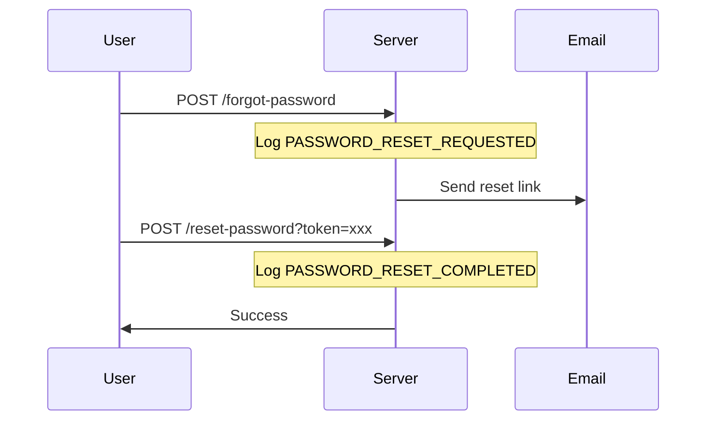
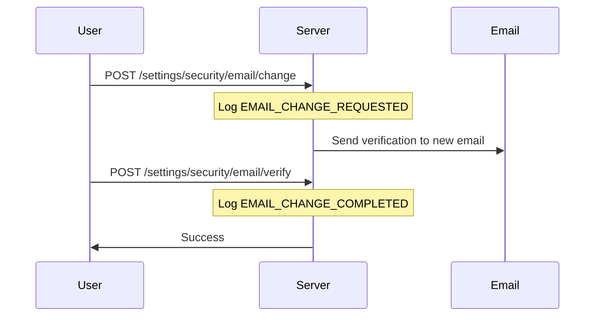

# Account Recovery Audit Trail

> Documentation for account recovery flow audit logging (P4-68).

## Overview

All account recovery operations are logged to the `audit_logs` table for compliance and security monitoring. This document describes what is logged and how to interpret the audit trail.

## Recovery Flow Events

### Password Reset Flow



### Email Change Flow



## Audit Event Types

| Event Type | Description | Logged Fields |
|------------|-------------|---------------|
| `PASSWORD_RESET_REQUESTED` | User requested password reset | email (hashed), IP, user agent |
| `PASSWORD_RESET_COMPLETED` | Password successfully reset | userId, IP, user agent |
| `PASSWORD_RESET_FAILED` | Reset token invalid/expired | attemptedToken (truncated), IP |
| `EMAIL_CHANGE_REQUESTED` | User requested email change | userId, newEmail (hashed), IP |
| `EMAIL_CHANGE_COMPLETED` | Email successfully changed | userId, oldEmail (hashed), newEmail (hashed) |
| `EMAIL_CHANGE_CANCELLED` | User cancelled email change | userId, pendingEmail (hashed) |
| `ACCOUNT_RECOVERED` | Account recovered via support | userId, supportTicketId, method |

## Logged Data

### Standard Fields

Every audit log entry contains:

```typescript
interface AuditLogEntry {
  id: string;                    // UUID
  eventType: string;             // Event type from above
  userId: string | null;         // User ID if known
  householdId: string | null;    // Household ID if applicable
  ipAddress: string;             // Request IP address
  userAgent: string;             // Browser/client info
  createdAt: Date;               // Timestamp (UTC)
  details: object;               // Event-specific data
}
```

### Privacy Considerations

Sensitive data is logged in a privacy-preserving manner:

| Field | Storage Method | Reason |
|-------|---------------|--------|
| Email | SHA-256 hash | Can verify, can't reverse |
| Password | Never logged | Security |
| Token | First 8 chars only | Debugging without exposure |
| IP Address | Full address | Rate limiting, geo analysis |

### Example Audit Log Entries

**Password Reset Requested:**
```json
{
  "id": "audit-123-456",
  "eventType": "PASSWORD_RESET_REQUESTED",
  "userId": null,
  "ipAddress": "192.168.1.100",
  "userAgent": "Mozilla/5.0...",
  "createdAt": "2026-01-27T10:30:00Z",
  "details": {
    "emailHash": "a1b2c3d4...",
    "requestSource": "web"
  }
}
```

**Password Reset Completed:**
```json
{
  "id": "audit-123-457",
  "eventType": "PASSWORD_RESET_COMPLETED",
  "userId": "user-789",
  "ipAddress": "192.168.1.100",
  "userAgent": "Mozilla/5.0...",
  "createdAt": "2026-01-27T10:35:00Z",
  "details": {
    "tokenPrefix": "abc12345",
    "timeToComplete": 300,
    "passwordStrength": "strong"
  }
}
```

## Compliance Requirements

### Zambia Data Protection Act

- Audit logs retained for **2 years**
- Access logs for sensitive operations required
- Breach notification within **72 hours**

### Internal Policy

| Requirement | Implementation |
|-------------|----------------|
| Who changed what | userId field |
| When was it changed | createdAt timestamp |
| From where | ipAddress, userAgent |
| What was the old value | Not stored (privacy) |
| What is the new value | Hashed or redacted |

## Monitoring & Alerting

### Suspicious Activity Triggers

| Pattern | Alert Level | Action |
|---------|-------------|--------|
| 5+ reset requests from same IP in 1 hour | Warning | Monitor |
| 10+ reset requests for same email in 24h | High | Investigate |
| Reset completed from different IP than request | Medium | Notify user |
| Multiple failed reset attempts | Warning | Rate limit |
| Email change to disposable domain | Warning | Review |

### Grafana Alert Rules

```yaml
# Password reset anomaly
- alert: PasswordResetAnomalyHigh
  expr: |
    sum(rate(audit_logs_total{event_type="PASSWORD_RESET_REQUESTED"}[5m])) > 10
  for: 5m
  labels:
    severity: warning
  annotations:
    summary: "High password reset request rate"

# Email change from new location
- alert: EmailChangeNewLocation
  expr: |
    audit_logs{event_type="EMAIL_CHANGE_COMPLETED"}
    unless on(userId) audit_logs{event_type="LOGIN_SUCCESS"}[7d]
  for: 0m
  labels:
    severity: high
  annotations:
    summary: "Email changed from never-seen IP"
```

## Query Examples

### Find All Recovery Activity for a User

```sql
SELECT
  event_type,
  ip_address,
  user_agent,
  created_at,
  details
FROM audit_logs
WHERE user_id = 'user-123'
  AND event_type IN (
    'PASSWORD_RESET_REQUESTED',
    'PASSWORD_RESET_COMPLETED',
    'EMAIL_CHANGE_REQUESTED',
    'EMAIL_CHANGE_COMPLETED'
  )
ORDER BY created_at DESC
LIMIT 50;
```

### Find Suspicious Reset Patterns

```sql
-- Multiple reset requests from same IP
SELECT
  ip_address,
  COUNT(*) as request_count,
  array_agg(DISTINCT details->>'emailHash') as email_hashes
FROM audit_logs
WHERE event_type = 'PASSWORD_RESET_REQUESTED'
  AND created_at > NOW() - INTERVAL '1 hour'
GROUP BY ip_address
HAVING COUNT(*) > 5
ORDER BY request_count DESC;
```

### Find Reset Requests Never Completed

```sql
-- Reset requested but not completed within 24 hours
SELECT
  a.details->>'emailHash' as email_hash,
  a.ip_address,
  a.created_at as requested_at
FROM audit_logs a
LEFT JOIN audit_logs b ON
  a.details->>'emailHash' = b.details->>'emailHash'
  AND b.event_type = 'PASSWORD_RESET_COMPLETED'
  AND b.created_at BETWEEN a.created_at AND a.created_at + INTERVAL '24 hours'
WHERE a.event_type = 'PASSWORD_RESET_REQUESTED'
  AND a.created_at > NOW() - INTERVAL '7 days'
  AND b.id IS NULL
ORDER BY a.created_at DESC;
```

## Support Procedures

### Legitimate Account Recovery

When a user contacts support for account recovery:

1. **Verify Identity**
   - Ask security questions (if configured)
   - Verify via alternate contact method
   - Request government ID (high-value accounts)

2. **Document the Request**
   - Create support ticket
   - Log `ACCOUNT_RECOVERED` event with ticket ID

3. **Perform Recovery**
   - Reset password via admin API
   - Send notification to all registered emails
   - Note in audit log: `method: "support_assisted"`

4. **Follow-up**
   - User must change password on next login
   - Email sent summarizing what was changed

### Fraudulent Recovery Attempt

If recovery attempt appears fraudulent:

1. **Do NOT complete recovery**
2. **Document the attempt** in audit log
3. **Notify the real user** via known contact
4. **Consider temporary account lock**
5. **Report to security team**

## Retention & Deletion

| Data Type | Retention Period | Deletion Method |
|-----------|-----------------|-----------------|
| Recovery audit logs | 2 years | Automated purge |
| Reset tokens | 24 hours | Expired, then purged |
| Email change tokens | 24 hours | Expired, then purged |
| Support tickets | 5 years | Manual review |

### GDPR Right to Erasure

Audit logs are **exempt** from right to erasure when:
- Required for legal compliance
- Required for security investigations
- Within retention period

After retention period, logs are automatically deleted.

## Related Documentation

- [Auth Session Strategy](../architecture/auth-session-strategy.md)
- [Penetration Testing Checklist](../security/auth-pentest-checklist.md)
- [Breach Notification Process](./breach-notification.md)
