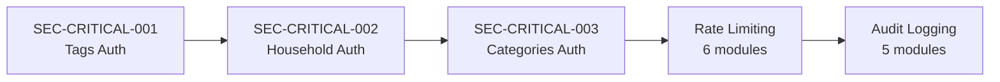

# Multi-Agent Implementation Plan

**Created:** 2026-01-27
**Source:** master-issues-registry.md (182 issues)
**Total Effort:** ~236 hours

This plan organizes 182 issues into parallelizable work streams using specialized agents that can run concurrently without conflicts.

---

## Execution Strategy

### Why Multi-Agent?

The 182 issues span 7 modules with different skill requirements:

- **Security fixes** require careful authorization logic
- **Test coverage** requires understanding test patterns
- **Accessibility** requires WCAG expertise
- **Money class** requires precision arithmetic knowledge
- **Type safety** requires TypeScript expertise

By assigning specialized agents to work in parallel on non-conflicting areas, we can:

1. **Reduce wall-clock time** from 6 weeks (serial) to ~2 weeks (parallel)
2. **Prevent merge conflicts** through careful file ownership
3. **Ensure expertise matching** - each agent focuses on their specialty

---

## Agent Definitions

### Agent 1: Security Specialist

**Focus:** Authorization, rate limiting, audit logging
**Skills:** CLAUDE.md Rules 9, 11, 12
**Works On:** P0 security issues across all modules

**Files Owned:**

```
server/modules/tags/tags.controller.ts (authorization)
server/modules/tags/tags.routes.ts (rate limiting)
server/modules/household/household.controller.ts (authorization)
server/modules/household/household.routes.ts (rate limiting)
server/modules/categories/categories.controller.ts (authorization)
server/modules/notifications/notifications.routes.ts (rate limiting)
server/modules/notifications/notifications.controller.ts (audit)
server/modules/weekly-recap/weekly-recap.routes.ts (rate limiting)
server/modules/weekly-recap/weekly-recap.controller.ts (audit)
server/modules/rules/rules.routes.ts (rate limiting)
server/routes/investment-notifications.ts (rate limiting + audit)
```

**Issues Assigned (27):**

- SEC-CRITICAL-001, SEC-CRITICAL-002, SEC-CRITICAL-003
- TAGS-SEC-001, TAGS-SEC-002, TAGS-SEC-003, TAGS-RATE-001, TAGS-AUDIT-001
- HOUSEHOLD-SEC-001, HOUSEHOLD-RATE-001, HOUSEHOLD-AUDIT-001, HOUSEHOLD-ERR-001
- CATS-SEC-001, CATS-SEC-002, CATS-SEC-003
- NOTIF-RATE-001, NOTIF-RATE-002, NOTIF-AUDIT-001, NOTIF-AUDIT-002, NOTIF-AUDIT-003, NOTIF-AUDIT-004
- WEEKLY-RATE-001, WEEKLY-AUDIT-001, WEEKLY-GUARD-001
- RULES-RATE-001

---

### Agent 2: Type Safety Specialist

**Focus:** `as any` removal, proper typing, validation schemas
**Skills:** CLAUDE.md Rule 16, Zod expertise
**Works On:** P0 type safety issues

**Files Owned:**

```
server/modules/rules/rules.validation.ts
server/services/rule/actions.ts
server/services/rule/matching.ts
server/services/MerchantService.ts
server/repositories/MerchantRepository.ts
server/modules/tags/tags.validation.ts (create new)
server/modules/weekly-recap/weekly-recap.validation.ts
client/src/hooks/useNotifications.ts
client/src/pages/settings/sections/NotificationsSection/NotificationsForm.tsx
```

**Issues Assigned (12):**

- RULES-TYPE-001, RULES-TYPE-002, RULES-TYPE-003, RULES-VAL-001
- MERCH-TYPE-001, MERCH-TYPE-002, MERCH-TYPE-003
- NOTIF-TYPE-001, NOTIF-TYPE-002
- TAGS-ERR-001, TAGS-ERR-002, TAGS-ERR-003, TAGS-VAL-001, TAGS-VAL-002

---

### Agent 3: Money Class Specialist

**Focus:** Financial precision, Money class usage
**Skills:** CLAUDE.md Rule 1
**Works On:** P0 money violations

**Files Owned:**

```
server/modules/weekly-recap/weekly-recap.service.ts
server/services/notification/service.ts
```

**Issues Assigned (5):**

- WEEKLY-MONEY-001, WEEKLY-MONEY-002, WEEKLY-MONEY-003
- RULES-MONEY-001 (coordinate with Agent 2 on actions.ts)
- NOTIF-MONEY-001

---

### Agent 4: Contract Alignment Specialist

**Focus:** Client-server type contracts
**Skills:** Shared types, API contracts
**Works On:** P1 contract mismatches

**Files Owned:**

```
shared/weekly-recap.ts (create new)
client/src/components/weekly-recap/hooks/useWeeklyRecapData.ts
client/src/components/weekly-recap/types.ts
```

**Issues Assigned (6):**

- WEEKLY-CONTRACT-001 through WEEKLY-CONTRACT-006

---

### Agent 5: Test Coverage Specialist (Server)

**Focus:** Server integration tests, repository tests
**Skills:** Vitest, supertest, test factories
**Works On:** P1 server test coverage

**Files Owned:**

```
server/modules/tags/__tests__/
server/modules/household/__tests__/
server/modules/notifications/__tests__/
server/modules/weekly-recap/__tests__/
server/modules/categories/__tests__/
server/modules/rules/__tests__/
server/repositories/__tests__/ (tag/notification repos)
```

**Issues Assigned (24):**

- TAGS-TEST-001 through TAGS-TEST-004
- HOUSEHOLD-TEST-001 through HOUSEHOLD-TEST-004
- NOTIF-TEST-001 through NOTIF-TEST-006, NOTIF-TEST-009
- WEEKLY-TEST-001, WEEKLY-TEST-002
- CATS-TEST-001, CATS-TEST-002
- RULES-TEST-001, RULES-TEST-002
- MERCH-TEST-002

---

### Agent 6: Test Coverage Specialist (Client)

**Focus:** Client hook tests, component tests
**Skills:** React Testing Library, Vitest
**Works On:** P1 client test coverage

**Files Owned:**

```
client/src/hooks/__tests__/
client/src/features/*/hooks/__tests__/
client/src/components/*/__tests__/
client/src/pages/settings/__tests__/
```

**Issues Assigned (8):**

- TAGS-TEST-005, TAGS-TEST-006
- NOTIF-TEST-007, NOTIF-TEST-008
- WEEKLY-TEST-003, WEEKLY-TEST-004
- CATS-TEST-003
- MERCH-TEST-001

---

### Agent 7: Accessibility Specialist

**Focus:** WCAG 2.1 AA compliance, aria labels, keyboard navigation
**Skills:** Accessibility patterns, screen reader testing
**Works On:** P2 accessibility issues

**Files Owned:**

```
client/src/components/tags/TagColorPicker.tsx
client/src/components/tags/TagBadge.tsx
client/src/components/tags/TagsMultiSelect.tsx
client/src/components/tags/TagsList.tsx
client/src/components/weekly-recap/WeeklyRecapWizard.tsx
client/src/components/weekly-recap/components/StepProgress.tsx
client/src/components/weekly-recap/components/WeeklyChart.tsx
client/src/components/merchants/MerchantCard.tsx
client/src/components/merchants/MergePreviewDialog.tsx
client/src/components/NotificationBell.tsx
client/src/pages/settings/sections/CategoriesSection/components/*.tsx
client/src/pages/settings/sections/RulesSection/components/*.tsx
client/src/pages/settings/sections/HouseholdSection/components/*.tsx
```

**Issues Assigned (30+):**

- TAGS-A11Y-001 through TAGS-A11Y-008
- WEEKLY-A11Y-001 through WEEKLY-A11Y-006
- HOUSEHOLD-A11Y-001 through HOUSEHOLD-A11Y-003
- NOTIF-UX-001 through NOTIF-UX-005
- CATS-A11Y-001 through CATS-A11Y-004
- MERCH-A11Y-001 through MERCH-A11Y-004
- RULES-A11Y-001 through RULES-A11Y-004

---

### Agent 8: LOC & Refactoring Specialist

**Focus:** File splits, architecture cleanup
**Skills:** Code organization, module patterns
**Works On:** P1 LOC violations, P2 architecture

**Files Owned:**

```
client/src/pages/settings/sections/MerchantsSection/hooks/useMerchantsSectionState.ts
client/src/pages/settings/sections/MerchantsSection/hooks/useMerchantFilters.ts (create)
client/src/pages/settings/sections/MerchantsSection/hooks/useMerchantBulkActions.ts (create)
client/src/pages/settings/sections/MerchantsSection/components/MerchantFormDialog.tsx
client/src/components/merchants/MerchantCombobox.tsx
client/src/components/merchants/MerchantComboboxItem.tsx (create)
client/src/pages/settings/sections/RulesSection/RuleEditorModal.tsx
server/services/MerchantService.ts (move to modules)
server/modules/merchants/index.ts (create)
```

**Issues Assigned (8):**

- MERCH-LOC-001, MERCH-LOC-002, MERCH-LOC-003
- RULES-LOC-001
- MERCH-ARCH-001, MERCH-ARCH-002
- TAGS-ARCH-001, TAGS-ARCH-002

---

### Agent 9: API Completeness Specialist

**Focus:** Missing endpoints, feature gaps
**Skills:** Express routing, controller patterns
**Works On:** P1-P2 API completeness

**Files Owned:**

```
server/modules/categories/categories.controller.ts (new endpoints only)
server/modules/categories/categories.routes.ts
server/modules/household/household.controller.ts (new endpoints only)
server/modules/household/household.routes.ts
server/modules/tags/tags.controller.ts (new endpoints only)
server/modules/tags/tags.routes.ts
server/modules/notifications/notifications.controller.ts (new endpoints only)
server/modules/notifications/notifications.routes.ts
server/modules/weekly-recap/weekly-recap.controller.ts (new endpoints only)
server/modules/weekly-recap/weekly-recap.routes.ts
server/modules/rules/rules.controller.ts (preview endpoint)
```

**Issues Assigned (20):**

- CATS-API-001, CATS-API-002, CATS-API-003
- HOUSEHOLD-API-001 through HOUSEHOLD-API-004
- HOUSEHOLD-FUNC-001, HOUSEHOLD-FUNC-002, HOUSEHOLD-FUNC-003
- TAGS-API-001, TAGS-API-002
- NOTIF-API-001 through NOTIF-API-004
- RULES-API-001

---

## Execution Phases

### Phase 1: Security Critical (Week 1)

**Blocking:** All other work
**Agents:** Security Specialist (Agent 1)



**Verification Gate:**

```bash
# Must pass before Phase 2 starts
npm run check
npm run test:server:run
rg -n "householdGuard" server/modules/tags/tags.routes.ts  # Must exist
rg -n "generalLimiter" server/modules/tags/tags.routes.ts  # Must exist
rg -n "findByIdWithVisibility" server/modules/tags/tags.controller.ts  # Must exist
```

---

### Phase 2: Type Safety & Money (Week 1-2, parallel with Phase 1 completion)

**Blocking:** None (different files)
**Agents:** Type Safety Specialist (Agent 2), Money Class Specialist (Agent 3)

**Agent 2 Work:**

```
RULES-TYPE-001 → RULES-TYPE-002 → RULES-TYPE-003 → RULES-VAL-001
MERCH-TYPE-001 → MERCH-TYPE-002 → MERCH-TYPE-003
NOTIF-TYPE-001 → NOTIF-TYPE-002
TAGS-ERR-* (parallel)
TAGS-VAL-* (parallel)
```

**Agent 3 Work:**

```
WEEKLY-MONEY-001 → WEEKLY-MONEY-002 → WEEKLY-MONEY-003
NOTIF-MONEY-001
```

**Coordination Point:** RULES-MONEY-001 requires both Agent 2 (typing) and Agent 3 (Money) to coordinate on `server/services/rule/actions.ts`.

**Solution:** Agent 2 fixes types first, Agent 3 reviews and fixes money logic after.

**Verification Gate:**

```bash
rg -n "as any" server/modules server/services server/repositories | wc -l  # Should decrease
rg -n "parseFloat|Number\(" server/modules/weekly-recap | grep -v test  # Should be 0
npm run check  # Must pass
```

---

### Phase 3: Contract Alignment (Week 2)

**Blocking:** None
**Agents:** Contract Alignment Specialist (Agent 4)

**Work:**

```
1. Create shared/weekly-recap.ts with WeeklyRecapResponse type
2. Update server to use shared type
3. Update client to use shared type
4. Fix all 6 contract mismatches
```

**Verification Gate:**

```bash
# Server and client should import same type
rg -n "WeeklyRecapResponse" shared/ server/ client/
npm run check
```

---

### Phase 4: Test Coverage (Week 2-3, parallel)

**Blocking:** Phases 1-2 (tests need fixed code)
**Agents:** Test Coverage Specialist Server (Agent 5), Test Coverage Specialist Client (Agent 6)

**Parallel Streams:**

| Agent 5 (Server)               | Agent 6 (Client)             |
| ------------------------------ | ---------------------------- |
| Tags integration tests         | Tags component tests         |
| Household integration tests    | Notifications hook tests     |
| Notifications repo tests       | Weekly recap component tests |
| Weekly recap integration tests | Categories component tests   |
| Categories/Rules tests         | Merchants component tests    |

**Verification Gate:**

```bash
npm run test:server:run  # All pass
npm run test:run  # All pass
rg -n "expect\(true\)\.toBe\(true\)" server/ client/  # Should be 0 (no stubs)
```

---

### Phase 5: Accessibility (Week 3-4, parallel with Phase 4)

**Blocking:** None (different files from tests)
**Agents:** Accessibility Specialist (Agent 7)

**Work Stream:**

```
Tags accessibility (8 issues) → Weekly Recap (6) → Notifications (5) →
Household (3) → Categories (4) → Merchants (4) → Rules (4)
```

**Verification Gate:**

```bash
# Check aria-labels added
rg -n "aria-label" client/src/components/tags/
rg -n "aria-label" client/src/components/weekly-recap/
# Run accessibility tests if available
```

---

### Phase 6: LOC & Architecture (Week 4)

**Blocking:** Phases 1-3 (stability first)
**Agents:** LOC & Refactoring Specialist (Agent 8)

**Work:**

```
1. Split useMerchantsSectionState.ts (547 LOC → 3 files)
2. Split MerchantFormDialog.tsx (365 LOC → 2 files)
3. Split MerchantCombobox.tsx (362 LOC → 2 files)
4. Split RuleEditorModal.tsx (318 LOC → 2 files)
5. Move MerchantService to modules/
6. Create Tags service layer
```

**Verification Gate:**

```bash
wc -l client/src/pages/settings/sections/MerchantsSection/hooks/useMerchantsSectionState.ts
# Must be < 300

npm run check
npm run test:run  # Ensure splits don't break tests
```

---

### Phase 7: API Completeness (Week 5)

**Blocking:** Phase 1 (security must be in place first)
**Agents:** API Completeness Specialist (Agent 9)

**Work Stream by Module:**

```
Categories: /seed, /reorder, /groups/reorder
Household: /invite/accept, /invite/resend, /transfer-ownership, /leave, /invitations
Tags: /:id/transactions, /transaction/:id
Notifications: /:id, /batch-read, /batch-archive, /types/:type
Weekly Recap: /settings, /history, /generate
Rules: /preview (real implementation)
```

**Verification Gate:**

```bash
# Test new endpoints
curl -X POST localhost:5000/api/categories/seed  # Should work or return conflict
npm run test:server:run
```

---

### Phase 8: Data Quality & Cleanup (Week 6)

**Blocking:** All previous phases
**Agents:** Any available

**Remaining Issues:**

- CATS-VAL-001, CATS-VAL-002, CATS-VAL-003
- MERCH-DATA-001, MERCH-DATA-002, MERCH-DATA-003
- WEEKLY-DATA-001
- All P3 feature gaps (defer or close)

---

## Parallel Execution Matrix

| Week | Agent 1  | Agent 2 | Agent 3 | Agent 4   | Agent 5 | Agent 6 | Agent 7 | Agent 8 | Agent 9 |
| ---- | -------- | ------- | ------- | --------- | ------- | ------- | ------- | ------- | ------- |
| 1    | Security | Types   | Money   | -         | -       | -       | -       | -       | -       |
| 2    | Audit    | Types   | Money   | Contracts | Tests   | Tests   | -       | -       | -       |
| 3    | -        | -       | -       | -         | Tests   | Tests   | A11y    | -       | -       |
| 4    | -        | -       | -       | -         | Tests   | Tests   | A11y    | LOC     | -       |
| 5    | -        | -       | -       | -         | -       | -       | A11y    | LOC     | API     |
| 6    | -        | -       | -       | -         | -       | -       | -       | -       | API     |

**Maximum Parallelism:** 6 agents running simultaneously (Week 3-4)

---

## Conflict Prevention Rules

### File Ownership

Each agent owns specific files. **No agent may modify another agent's files** without explicit handoff.

### Shared File Coordination

When multiple agents need the same file:

| File                                               | Primary            | Secondary               | Handoff                |
| -------------------------------------------------- | ------------------ | ----------------------- | ---------------------- |
| `server/services/rule/actions.ts`                  | Agent 2 (types)    | Agent 3 (money)         | Agent 2 finishes first |
| `server/modules/tags/tags.controller.ts`           | Agent 1 (security) | Agent 9 (new endpoints) | Agent 1 finishes first |
| `server/modules/household/household.controller.ts` | Agent 1 (security) | Agent 9 (new endpoints) | Agent 1 finishes first |

### Branch Strategy

```
main
├── fix/security-p0 (Agent 1)
├── fix/types-p0 (Agent 2)
├── fix/money-p0 (Agent 3)
├── fix/contracts-p1 (Agent 4)
├── test/server-coverage (Agent 5)
├── test/client-coverage (Agent 6)
├── fix/accessibility-p2 (Agent 7)
├── refactor/loc-splits (Agent 8)
└── feat/api-completeness (Agent 9)
```

**Merge Order:**

1. `fix/security-p0` → main (blocking)
2. `fix/types-p0`, `fix/money-p0` → main (parallel)
3. `fix/contracts-p1` → main
4. All others → main (any order)

---

## Agent Invocation Commands

### Starting Agents in Parallel

Use Claude Code's Task tool with `run_in_background: true` to launch multiple agents:

```typescript
// Example: Launch security and types agents in parallel
Task({
  description: "Fix security P0 issues",
  prompt: `You are the Security Specialist agent. Your task is to fix all P0 security issues...`,
  subagent_type: "general-purpose",
  run_in_background: true,
});

Task({
  description: "Fix type safety P0 issues",
  prompt: `You are the Type Safety Specialist agent. Your task is to fix all P0 type safety issues...`,
  subagent_type: "general-purpose",
  run_in_background: true,
});
```

### Agent Prompts

**Agent 1 - Security Specialist:**

```
You are fixing security issues in the personal-finance-app.

Your assigned issues:
- SEC-CRITICAL-001: Tags authorization bypass (server/modules/tags/tags.controller.ts)
- SEC-CRITICAL-002: Household privilege escalation (server/modules/household/household.controller.ts)
- SEC-CRITICAL-003: Categories cross-tenant (server/modules/categories/categories.controller.ts)
- Rate limiting: Add generalLimiter to 6 route files
- Audit logging: Add businessAuditService calls to 5 controller files

Files you own (only modify these):
[list of files from Agent 1 definition]

After each fix:
1. Run npm run check
2. Run npm run test:server:run
3. Verify with grep that the pattern is fixed

Reference master-issues-registry.md for exact fix patterns.
```

**Agent 5 - Test Coverage Specialist (Server):**

```
You are adding server integration tests to the personal-finance-app.

Your assigned modules:
- Tags: Create tags.integration.test.ts with authorization, CRUD, transaction-tag tests
- Household: Create household.integration.test.ts with role, edge-case tests
- Notifications: Create notifications.integration.test.ts
- Weekly Recap: Create weekly-recap.integration.test.ts
- Categories: Expand existing tests, remove stubs
- Rules: Add concurrency and boundary tests

Test patterns to follow:
1. Use supertest for HTTP testing
2. Use test factories from server/test/factories
3. Test authorization boundaries (cross-household should fail)
4. Test validation (bad input should return 400)
5. Test not found (missing resource should return 404)

After each test file:
1. Run npm run test:server:run -- --grep "ModuleName"
2. Verify no stub tests remain: grep "expect(true).toBe(true)"
```

---

## Verification Checkpoints

### After Phase 1 (Security)

```bash
# All security issues fixed
rg -n "findByIdWithVisibility\|requireRole" server/modules/tags server/modules/household server/modules/categories

# All rate limiters in place
for f in tags household notifications weekly-recap rules; do
  rg -n "generalLimiter" server/modules/$f/*routes.ts
done

# All audit logging in place
rg -n "businessAuditService" server/modules/tags server/modules/household server/modules/notifications server/modules/weekly-recap
```

### After Phase 2 (Types + Money)

```bash
# No more as any in production code
rg -n "as any" server/modules server/services --glob '!*test*' | wc -l

# No z.any() in validation
rg -n "z\.any\(\)" server/modules

# No parseFloat on financial data
rg -n "parseFloat" server/modules/weekly-recap server/services/rule --glob '!*test*'
```

### After Phase 4 (Tests)

```bash
# Run full test suite
npm run test:server:run
npm run test:run

# Check coverage (if configured)
npm run test:server:coverage
```

### Final Verification

```bash
npm run check              # TypeScript clean
npm run test:server:run    # Server tests pass
npm run test:run           # Client tests pass

# Count remaining issues
rg -n "as any" server/ client/ --glob '!*test*' --glob '!*.d.ts' | wc -l
rg -n "parseFloat" server/ --glob '!*test*' | wc -l
rg -n "expect\(true\)\.toBe\(true\)" server/ client/ | wc -l
```

---

## Timeline Summary

| Week      | Primary Focus            | Agents Active | Issues Closed |
| --------- | ------------------------ | ------------- | ------------- |
| 1         | Security + Types + Money | 3             | ~45           |
| 2         | Tests + Contracts        | 4             | ~30           |
| 3         | Tests + Accessibility    | 4             | ~35           |
| 4         | Tests + A11y + LOC       | 4             | ~30           |
| 5         | A11y + API               | 3             | ~25           |
| 6         | API + Cleanup            | 2             | ~17           |
| **Total** |                          |               | **182**       |

---

## Risk Mitigation

### Merge Conflicts

- **Prevention:** Strict file ownership
- **Detection:** CI runs on all branches
- **Resolution:** Coordinator merges in defined order

### Test Failures After Security Changes

- **Prevention:** Agent 5 waits for Agent 1 to complete Phase 1
- **Detection:** Run tests after each security fix
- **Resolution:** Agent 1 fixes any regressions before handoff

### Scope Creep

- **Prevention:** Agents only work on assigned issues
- **Detection:** Code review checks issue IDs in commits
- **Resolution:** Defer new issues to backlog

---

## Success Criteria

- [ ] 0 security issues (SEC-CRITICAL-001, 002, 003 closed)
- [ ] 100% rate limiting coverage (all routes have limiters)
- [ ] 100% audit logging coverage (all mutations logged)
- [ ] 0 `as any` casts in production code
- [ ] 0 `parseFloat` on financial data
- [ ] 0 stub tests
- [ ] 0 LOC violations
- [ ] All P0/P1 issues closed
- [ ] 80%+ module test coverage
- [ ] `npm run check` passes
- [ ] `npm run test:server:run` passes
- [ ] `npm run test:run` passes

---

## References

- [master-issues-registry.md](./master-issues-registry.md) - Complete issue list
- [CLAUDE.md](../../CLAUDE.md) - Coding standards
- Individual module overhaul plans in this directory
