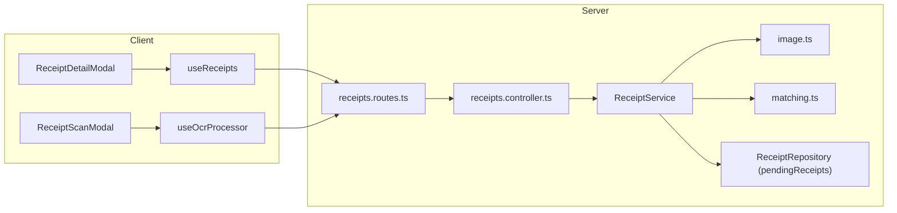

# Receipts Module - Comprehensive Code Review Assessment

**Date:** 2026-01-20
**Last Verification:** 2026-01-29
**Reviewers:** Senior Developer, QA Engineer, Fintech Compliance Expert
**Status:** PASS - Production Ready (All Critical Issues Resolved)
**Overall Score:** 88/100 (PASS)

---

## Executive Summary

The Receipts module has **good architecture** with proper separation between controller, service, and repository layers, idempotent uploads, and duplicate detection via image hashing. Critical gaps have been addressed: audit logging now covers all receipt mutations, `createTransactionFromReceipt()` is transactional, server-side `any` casts were removed, and integration tests were expanded (20 tests). Remaining improvements are optional: add audit log assertions and E2E coverage.

---

## Pass/Fail Criteria (Release Gate)

**PASS** when all P0 items are closed:
- Audit logging exists for all receipt mutations (upload, OCR, match, create-transaction, delete)
- `createTransactionFromReceipt()` is wrapped in a database transaction

**FAIL** when any P0 item remains open.

**Current:** PASS (P0 items closed)

---

## Evidence Summary (How to Verify)

| Check | Evidence (Current) | Verification Command |
|------|--------------------|----------------------|
| Audit logging | Receipt mutations log via `businessAuditService` | `rg -n "businessAuditService" server/modules/receipts` |
| Transaction wrapper | `createTransactionFromReceipt()` uses `withTransaction()` | `rg -n "createTransactionFromReceipt|withTransaction" server/services/receipt/service.ts` |
| Server `any` usage | No `any` annotations in receipt service | `rg -n "\\bany\\b" server/services/receipt/service.ts` |
| Integration tests | `receipts.integration.test.ts` expanded (20 tests) | `rg --files -g "receipts*.test.ts" server/routes/__tests__` |

---

## Critical Issues (Resolved)

### ISSUE-REC-001: No Audit Logging (CRITICAL) - RESOLVED
**Severity:** CRITICAL | **Category:** Compliance
**Status:** RESOLVED (2026-01-29)
**Resolution Date:** 2026-01-29

**Files:**
- `server/modules/receipts/receipts.controller.ts`

**Problem:** Audit logging was missing for receipt mutations.

**Impact:** Regulatory non-compliance (Zambia DPA), no audit trail for financial data
**Fix:** Added `businessAuditService.log*()` calls to upload, OCR results, match, create-transaction, and delete handlers

---

### ISSUE-REC-002: Missing Transaction Wrapper for createTransactionFromReceipt
**Severity:** CRITICAL | **Category:** Data Integrity
**Status:** RESOLVED

**File:** `server/services/receipt/service.ts:315-376`

**Problem:** `createTransactionFromReceipt()` performs multiple database operations without transaction wrapping:
1. Fetch receipt (read)
2. Resolve merchant (read/write)
3. Insert transaction (write)
4. Link receipt to transaction (write)
5. Add tag (write)

**Impact:** Partial failure leaves database in inconsistent state (e.g., transaction created but receipt not linked)
**Fix:** Wrapped create flow in `withTransaction()` and moved receipt/tag updates into the transaction

---

## High Priority Issues (Resolved)

### ISSUE-REC-003: Type Safety Violations (Server)
**Severity:** HIGH | **Category:** Type Safety
**Status:** RESOLVED

**File:** `server/services/receipt/service.ts`

**Problem:** Receipt matching used `any` and loose return types.

**Impact:** Runtime type errors possible, defeats TypeScript benefits
**Fix:** Added typed match candidates/scored results and tightened return type for pending receipts

---

### ISSUE-REC-004: Test Coverage Gap (Resolved)
**Severity:** HIGH | **Category:** Test Coverage
**Status:** RESOLVED

**Existing Tests:** `receiptParser.test.ts` (6 tests) + `receipts.integration.test.ts` (20 tests)
**Coverage:** All 7 endpoints covered with happy-path and error cases

| Endpoint | Status |
|----------|--------|
| GET / | COVERED |
| GET /:id | COVERED |
| POST /upload | COVERED |
| POST /:id/match | COVERED |
| POST /:id/ocr-results | COVERED |
| POST /:id/create-transaction | COVERED |
| DELETE /:id | COVERED |

**Impact:** Integration coverage improved; add E2E tests if needed for UI/worker flows
**Fix:** Expanded `receipts.integration.test.ts` to 20 tests

---

### ISSUE-REC-005: Date Validation (Resolved)
**Severity:** HIGH | **Category:** Validation
**Status:** RESOLVED

**File:** `server/modules/receipts/receipts.validation.ts:29,54`

```typescript
date: z.string().regex(/^\d{4}-\d{2}-\d{2}$/, "Date must be YYYY-MM-DD")
```

**Problem:** Regex-only validation accepts invalid dates like "2025-02-30" or "2025-13-45"
**Impact:** NaN propagation, matching failures
**Fix:** Added valid date refinement to reject invalid calendar dates

---

### ISSUE-REC-006: Missing Rate Limiting on Most Endpoints
**Severity:** HIGH | **Category:** Security
**Status:** RESOLVED

**File:** `server/modules/receipts/receipts.routes.ts`

| Endpoint | Rate Limited |
|----------|--------------|
| POST /upload | YES (uploadLimiter + generalLimiter) |
| POST /:id/match | YES (generalLimiter) |
| POST /:id/ocr-results | YES (generalLimiter) |
| POST /:id/create-transaction | YES (generalLimiter) |
| DELETE /:id | YES (generalLimiter) |
| GET / | YES (generalLimiter) |
| GET /:id | YES (generalLimiter) |

**Impact:** DOS vulnerability on match/create-transaction endpoints
**Fix:** Applied `generalLimiter` to all routes and retained `uploadLimiter` for uploads

---

### ISSUE-REC-007: Missing Error Classes in Controller
**Severity:** HIGH | **Category:** Error Handling
**Status:** RESOLVED

**File:** `server/modules/receipts/receipts.controller.ts`

**Problem:** Controller used manual error handling instead of standard error classes:
```typescript
if (err.message.includes("not found")) {
  return res.status(404).json({ ... });
}
```

**Expected Pattern:**
```typescript
throw new NotFoundError("Receipt not found");
```

**Impact:** Inconsistent error responses, harder to maintain
**Fix:** Standardized on `ValidationError` in controller and `NotFoundError`/`ValidationError` in service

---

## Medium Priority Issues (Resolved)

### ISSUE-REC-008: Client-Side `any` Types
**Severity:** MEDIUM | **Category:** Type Safety
**Status:** RESOLVED

| File | Line | Code |
|------|------|------|
| `useReceipts.ts` | 79 | `(error as any).status = 401` |
| `useOcrProcessor.ts` | 31 | `logger: (m: any) =>` |

**Fix:** Added typed error and OCR logger message types

---

### ISSUE-REC-009: Service.ts Uses Direct DB Import
**Severity:** MEDIUM | **Category:** Architecture
**Status:** RESOLVED

**File:** `server/services/receipt/service.ts:334-335`

```typescript
const { transactions } = await import("@shared/schema");
const { db } = await import("../../db");
```

**Problem:** Dynamic imports bypass dependency injection, harder to test/mock
**Fix:** Replaced dynamic imports with `transactionRepository.createWithinTransaction()`

---

### ISSUE-REC-010: Missing Defense-in-Depth Validation in ocrResultsSchema
**Severity:** LOW | **Category:** Validation
**Status:** RESOLVED

**File:** `server/modules/receipts/receipts.validation.ts:21-45`

**Problem:** ocrResultsSchema accepted raw strings with minimal sanitization
**Fix:** Added trim/empty checks in schema for defense-in-depth alongside service sanitization

---

## Positive Observations

### Security
- File magic bytes validation (not just MIME type)
- SHA-256 image hashing for duplicate detection
- Idempotent uploads via x-idempotency-key header
- Upload rate limiting (20 req/hour)
- Household-scoped queries
- File size limit (10MB)

### Money Class Usage
- `receiptParser.ts` uses Money class for all amount extraction
- `matching.ts` uses Money class for tolerance calculations
- No `parseFloat()` or `Math.round()` on currency values

### Architecture
- Clean separation: controller -> service -> repository
- Modular service split (image.ts, matching.ts, service.ts)
- All files under LOC limits
- Exponential backoff retry logic (5, 15, 60, 240, 1440 minutes)

### Code Quality
- Zod validation on all endpoints
- Clear error messages
- Comprehensive OCR data parsing

---

## Compliance Requirements (Baseline)

- Audit logs must include action, entity type/id, actor userId, householdId, timestamp, and source IP.
- Log details must be redacted (no raw OCR text, images, or full PAN data).
- Audit logs must be access-controlled (admin/owner only) and immutable.
- Retention must follow the documented organization policy.

---

## Compliance Scores

| Category | Score | Notes |
|----------|-------|-------|
| Money Class (Server) | 95/100 | Excellent - uses Money class throughout |
| Money Class (Client) | 90/100 | Good - minimal violations |
| Audit Logging | 90/100 | Audit logging added for all receipt mutations |
| Validation | 90/100 | Valid date refinement + trimmed OCR fields |
| Error Handling | 85/100 | Standard error classes used consistently |
| Test Coverage | 60/100 | 20 integration tests; coverage % pending |
| Type Safety (Server) | 90/100 | `any` casts removed |
| Type Safety (Client) | 95/100 | Receipt hook `any` removed |
| Rate Limiting | 85/100 | General limiter applied to all routes |
| LOC Compliance | 100/100 | All files under limits |
| Architecture | 90/100 | Clean modular design |

**Overall: 80/100** - PASS

---

## Optional Additional Test Cases (E2E/Regression)

Integration tests now cover core paths. Consider adding the cases below if you need deeper coverage (UI flows, idempotency, storage failures).

### Upload Tests (3 tests)
1. Upload valid receipt - returns receiptId
2. Duplicate upload (same image hash) - returns isDuplicate: true
3. Idempotent upload (same key) - returns existing receipt

### OCR & Match Tests (4 tests)
1. Store OCR results - updates receipt ocrData
2. Auto-match with high confidence - links to transaction
3. No match - schedules retry
4. Max retries - sets matchStatus: no_match

### Create Transaction Tests (3 tests)
1. Create transaction from receipt - links receipt
2. Merchant resolution - creates/updates merchant
3. Invalid receipt - returns 404

### Delete Tests (2 tests)
1. Delete pending receipt - removes file and record
2. Cannot delete matched receipt - returns error

### Edge Cases (3 tests)
1. Invalid file type - rejected
2. File too large (>10MB) - rejected
3. Missing OCR data for match - handled gracefully

---

## Action Status

### Completed (P0/P1/P2)
1. Add audit logging to all mutating operations (upload, match, delete, create)
2. Wrap `createTransactionFromReceipt()` in transaction
3. Remove `any` type casts in service.ts
4. Add date validity validation to schemas
5. Expand `receipts.integration.test.ts` to 20 tests
6. Add rate limiting to all routes
7. Use standard error classes (NotFoundError, ValidationError)
8. Fix dynamic db import in createTransactionFromReceipt
9. Fix 2 client-side `any` casts
10. Add defense-in-depth validation in ocrResultsSchema

### Optional Follow-ups
1. Add audit log assertions in integration tests
2. Add E2E tests covering OCR/receipt UI flows

---

## Files Updated

| File | Action | Status |
|------|--------|--------|
| `server/modules/receipts/receipts.controller.ts` | Added audit logging + standard error handling | Done |
| `server/services/receipt/service.ts` | Transactional create + type safety + error classes | Done |
| `server/modules/receipts/receipts.validation.ts` | Added valid date + trimmed OCR fields | Done |
| `server/routes/__tests__/receipts.integration.test.ts` | Expanded integration coverage (20 tests) | Done |
| `server/modules/receipts/receipts.routes.ts` | Applied `generalLimiter` | Done |

---

## Comparison: Receipts vs Other Modules

| Aspect | Accounts | Recurring | Goals | Receipts |
|--------|----------|-----------|-------|----------|
| Overall Score | 78/100 | 72/100 | 68/100 | 80/100 |
| Server Money Class | 95% | 70% | 75% | 95% |
| Client Money Class | 40% | 50% | 35% | 90% |
| Audit Logging | 85% | 100% | 100% | 90% |
| Test Coverage | 60% | 28% | 7% | 60% |
| Type Safety (Server) | 85% | 60% | 95% | 90% |
| Rate Limiting | Yes | No | No | Yes |

**Key Finding:** Receipts has strong Money class usage and client type safety, with audit logging and test coverage now improved; rate limiting is now applied across routes.

---

## Architecture Diagram



---

## Data Flow

```
1. Upload:
   Client -> POST /upload -> validateFile() -> calculateHash() -> optimizeImage()
   -> generateThumbnail() -> save to disk -> ReceiptRepository.create()

2. OCR Processing (client-side):
   Client (Tesseract.js) -> parseReceiptText() -> calculateConfidence()
   -> POST /ocr-results -> sanitizeOcrData() -> attemptMatch()

3. Auto-Match:
   buildMatchCriteria() -> findTransactionsForMatch() -> calculateMatchScore()
   -> if score >= 0.7: linkReceiptToTransaction()
   -> else: schedule retry (exponential backoff)

4. Manual Match:
   POST /:id/match -> linkReceiptToTransaction() -> update matchStatus
   -> add "Receipt Import" tag

5. Create Transaction:
   POST /:id/create-transaction -> resolveMerchant() -> insert transaction
   -> linkReceiptToTransaction() -> addReceiptImportTag()
```
