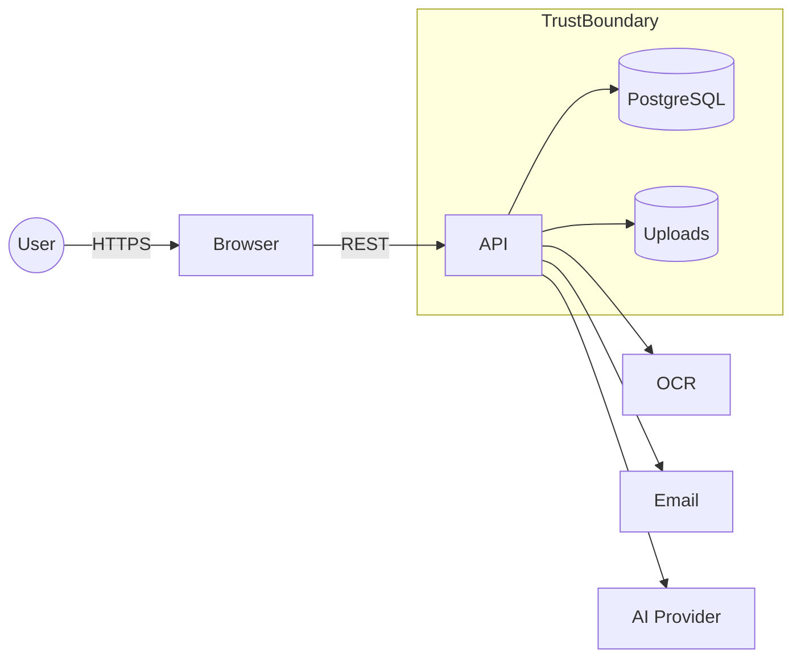

# Threat Model

## Scope
- Web client and API
- Session management and authentication
- Uploads and OCR processing
- Reporting and exports
- Household and member management

## Assumptions
- All traffic is served over HTTPS
- Database credentials are stored in managed secrets
- The API is the only write path to the database
- Background jobs run with least privilege

## Trust Boundaries

## Assets
- User PII and financial records
- Session cookies and auth tokens
- Uploaded receipts and profile images
- Exported CSVs and reports
- Audit logs and access logs

## Entry Points
- Public web client
- API endpoints
- Webhooks and background job queues
- File upload pipeline

## Threats and Mitigations
| Threat | Example | Mitigation |
| --- | --- | --- |
| Credential stuffing | Brute force login attempts | Rate limiting, lockout policy, MFA |
| CSRF | Cross-site request forgery | CSRF token required for mutations |
| Session hijacking | Stolen cookie | httpOnly, Secure cookies, session rotation |
| Injection | SQL or command injection | Zod validation, parameterized queries |
| Data leakage | Logging sensitive data | PII redaction, avoid payload logging |
| Broken authz | Cross-household access | Household guards on all queries |
| Upload abuse | Malicious files | File type validation, size limits |
| Export abuse | Bulk data exfiltration | Rate limits, audit logging |
| Provider failure | OCR or AI outage | Graceful fallbacks, feature flags |

## Residual Risks
- OCR and uploads require careful sandboxing
- Multi-tenant data access depends on household guards
- CSV exports can leak data if shared externally
- External providers can introduce availability risk

## Planned Improvements
- Continuous security testing for authz and exports
- Automated abuse detection for exports and uploads
- Regular threat model review each major release
