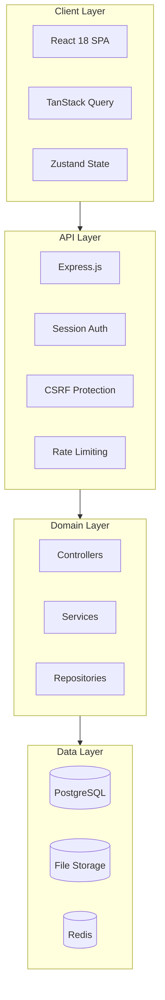
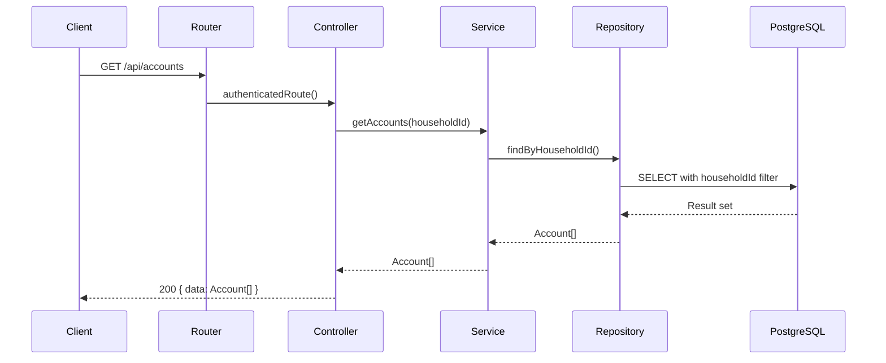
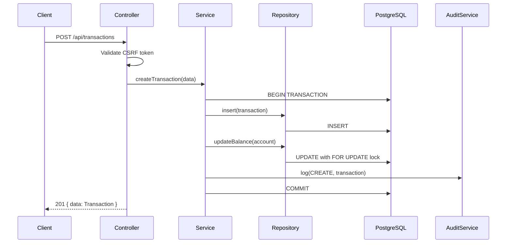
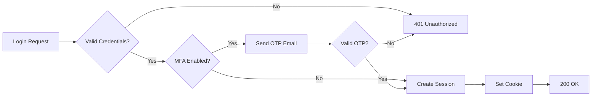
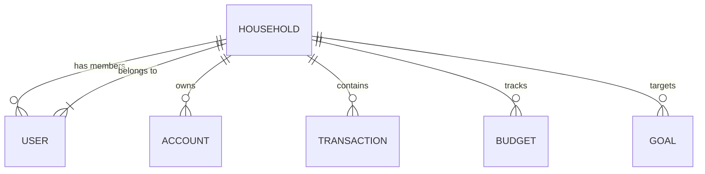

# Architecture

## Personal Finance Application

**Document Version:** 2.0  
**Last Updated:** 2026-02-06

---

## 1. High-Level Architecture

The application follows a layered architecture pattern with clear separation of concerns:



---

## 2. Layer Responsibilities

### 2.1 Client Layer

| Component          | Responsibility                              |
| ------------------ | ------------------------------------------- |
| **React SPA**      | UI rendering, routing, component lifecycle  |
| **TanStack Query** | Server state management, caching, mutations |
| **Zustand**        | Client-side state (UI preferences, modals)  |
| **Radix UI**       | Accessible component primitives             |
| **Tailwind CSS**   | Styling and responsive design               |

### 2.2 API Layer

| Component           | Responsibility                                |
| ------------------- | --------------------------------------------- |
| **Express.js**      | HTTP server, routing, middleware pipeline     |
| **Session Auth**    | PostgreSQL-backed session storage             |
| **CSRF Protection** | Double-submit cookie (csrf-csrf library)      |
| **Rate Limiting**   | Per-endpoint request limits                   |
| **Helmet**          | Security headers (CSP, HSTS, X-Frame-Options) |

### 2.3 Domain Layer

| Component        | Responsibility                                                    |
| ---------------- | ----------------------------------------------------------------- |
| **Controllers**  | HTTP handling only - parse request, call service, format response |
| **Services**     | Business logic, validation, cross-cutting concerns                |
| **Repositories** | Data access, queries, transactions                                |

### 2.4 Data Layer

| Component        | Responsibility                             |
| ---------------- | ------------------------------------------ |
| **PostgreSQL**   | Primary data store, transactions, sessions |
| **File Storage** | Uploads (receipts, logos, profiles)        |
| **Redis**        | Optional distributed rate limiting         |

---

## 3. Module Architecture

The application is organized into 19 domain modules:

```
server/modules/
├── auth/           # Authentication, session, MFA
├── accounts/       # Account CRUD, balances
├── transactions/   # Transaction management
├── budgets/        # Budget tracking, rollover
├── goals/          # Savings and investment goals
├── investments/    # Holdings, securities, performance
├── reports/        # Analytics, exports
├── recurring/      # Scheduled transactions
├── merchants/      # Merchant management
├── categories/     # Category hierarchy
├── rules/          # Auto-categorization engine
├── tags/           # Transaction tagging
├── receipts/       # Receipt uploads, OCR
├── notifications/  # Preferences, digests
├── settings/       # User and household settings
├── household/      # Multi-tenancy management
├── health/         # Health checks
├── ai/             # AI insights (optional)
└── weekly-recap/   # Weekly email digest
```

### Module Structure

Each module follows a consistent structure:

```
module/
├── module.controller.ts    # HTTP handlers
├── module.service.ts       # Business logic
├── module.repository.ts    # Data access
├── module.routes.ts        # Route definitions
├── module.schemas.ts       # Zod validation
└── __tests__/              # Tests
```

---

## 4. Data Flow Patterns

### 4.1 Read Flow (Query)



### 4.2 Write Flow (Mutation)



---

## 5. Security Architecture

### 5.1 Authentication Flow



### 5.2 Security Controls

| Control                | Implementation                          |
| ---------------------- | --------------------------------------- |
| **Session Management** | express-session + PostgreSQL store      |
| **CSRF Protection**    | csrf-csrf double-submit cookie          |
| **Rate Limiting**      | express-rate-limit (tiered by endpoint) |
| **Input Validation**   | Zod schemas on all endpoints            |
| **SQL Injection**      | Drizzle ORM parameterized queries       |
| **XSS Prevention**     | Response sanitization, CSP headers      |
| **Password Security**  | bcrypt 12 rounds                        |
| **Audit Logging**      | BusinessAuditService for mutations      |

---

## 6. Multi-Tenancy Model

The application uses **Household-Based Isolation**:



### Isolation Enforcement

- Every query includes `householdId` filter
- Repository layer enforces this pattern
- Cross-household access prevented at controller level
- Property-based tests verify isolation

---

## 7. Key Libraries

| Library            | Purpose           | Why Chosen                          |
| ------------------ | ----------------- | ----------------------------------- |
| **Drizzle ORM**    | Database access   | Type-safe, performant               |
| **Zod**            | Schema validation | TypeScript-native, composable       |
| **bcrypt**         | Password hashing  | Proven, secure                      |
| **Helmet**         | Security headers  | Industry standard                   |
| **decimal.js**     | Currency math     | Prevents floating-point errors      |
| **csrf-csrf**      | CSRF protection   | Modern double-submit implementation |
| **TanStack Query** | Server state      | Excellent caching, DX               |

---

## 8. Scalability Considerations

### Current Design (Single Instance)

- PostgreSQL for session storage
- In-memory rate limiting
- Local file uploads

### Multi-Instance Ready

- Redis for distributed rate limiting
- S3/external storage for uploads
- PostgreSQL connection pooling

---

## 9. Related Documentation

| Document                                                      | Purpose                   |
| ------------------------------------------------------------- | ------------------------- |
| [System Overview](overview.md)                                | Business context          |
| [Data Flows](data-flows.md)                                   | Detailed request patterns |
| [SDD](../specifications/sdd.md)                               | System design document    |
| [Security Architecture](../security/security-architecture.md) | Security details          |

---

_Document expanded: 2026-02-06 as part of documentation re-audit (Task 3.2)_
